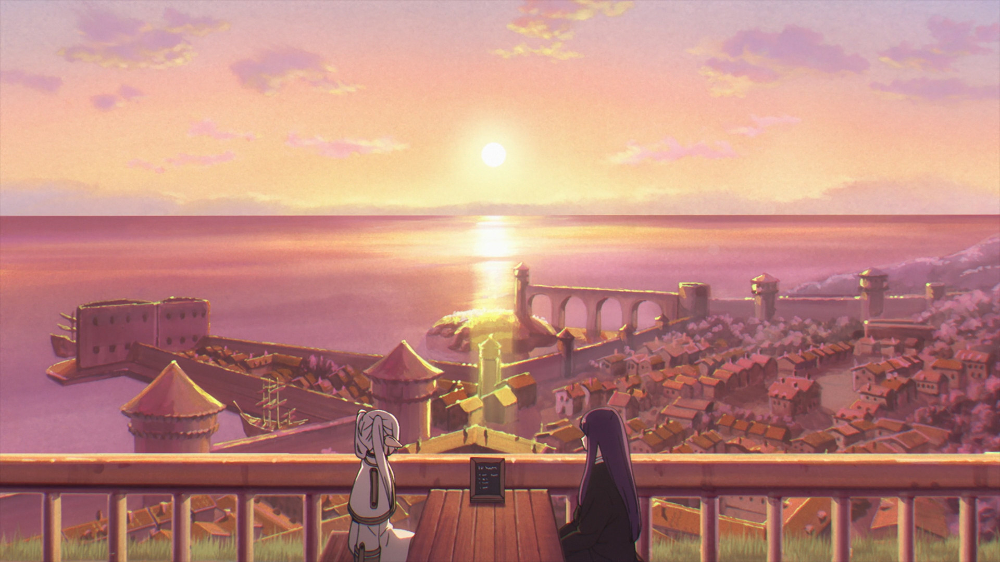
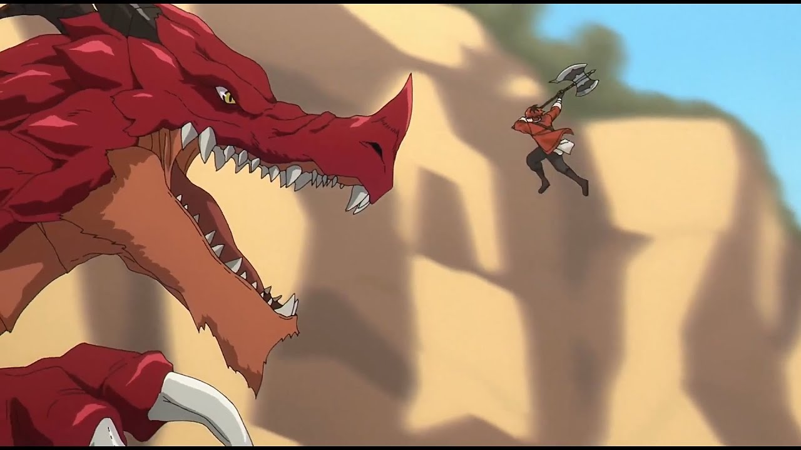
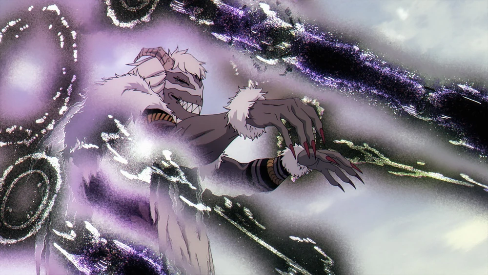

## The beginning

This blog will majorly be a large set of reviews discussions and my options on animes games and the likes. Before i start critiquing or revewing other forms of media i find it pertinent to set my standards of a good anime. This is where we reach frieren.

For the honestly impressive person who doesnt know friren it is the story about the elf mage of the heros party AFTER the demon lord was killed. This is one of the reasons i love frieren.

This comes from a series by pey talks anime called exploring frieren [(here)](https://youtu.be/bSLaiizCZFw?si=CNP1Y1SB3OldJkKM). I really enjoyed this series, it was such an eyeopening series on the depth on media and why we can call it art.

## the bag of paradoxes

Frieren is the biggest hate letter to every story trope and it works so well. Frieren starts after the demon lord is killed rather than being a story about that journey. Friren the main character of the story (obviously as its namesake) is constantly overshadowed by other side characters in the sense of a main character. A chivarlous, proud and faultless character (obviously HIMmel) is not the main character beucase this isnt a traditional story, its a story about a lonely elf finally realizing what relationship mean and why its so important.

## animation

before i gush about the characters, the worldbuilding and the plot i want to first talk about the animation.

Compared to other animations Frirens feels truly alive in motion, many other anime seem to show static images with light animation to create the illusion of movement. Some take it too far like *cough*OPM season 3*cough* but for most it looks good. But for friren every frame feels like a work of art effortlessly blending together like this wonderful scene.

Moreover i love the attention to detail. When qual casts Zoltraak, since it his original spell we see it simply come into space.

However when any human mage casts ordinary offence magic we see them first conjure a magic circle then their version of zoltraak to show the difference in principle and that ordinary offence magic was a recreation of zoltraak.

## worldbuilding

Worldbuilding in friren is slow but decisive, in the show its more like history building as we go on our new journey we reach new places to us but old places to friren. Through new expiriences friren gains a new perspective on the memories she belived held no value. Each element we add to this tapestry has such emotional depth that it makes the
