_Season 1 Episodes 24–25 and R2 Episodes 1–7. Spoilers through R2 Episode 7 only._

Lelouch vi Britannia has a remarkable talent for turning disaster into opportunity.

Surround him with enemies, deprive him of resources, and give him a seemingly impossible objective, and he'll probably find some ridiculous way to turn the situation around.

But what happens when the obstacle isn't military?

What happens when the person standing between Lelouch and his revolution is someone he loves?

The end of _Code Geass_'s first season and the beginning of R2 expose something that has been developing since the series began.

Lelouch has built an extraordinary political identity in Zero. He has transformed a scattered resistance into an organization capable of challenging Britannia. He has convinced thousands of people to risk their lives for his cause.

Yet the person beneath the mask has never fully resolved why he's fighting.

He says he's doing it for Nunnally.

He wants revenge against the Emperor.

He wants to destroy Britannia's oppressive system.

He wants to protect his friends.

He wants to build a better world.

These motivations overlap, but they are not interchangeable.

And when they finally collide, Lelouch discovers that being a revolutionary leader means accepting responsibilities that cannot simply be discarded when his personal circumstances change.

## The Black Rebellion: A Victory That Never Happened

The Black Rebellion is the moment when Zero's military ambitions seem closest to becoming reality.

The Black Knights have developed into a serious fighting force. Britannia's position in Japan is under enormous pressure. Lelouch has spent the season constructing the conditions for precisely this confrontation.

And then Nunnally is taken.

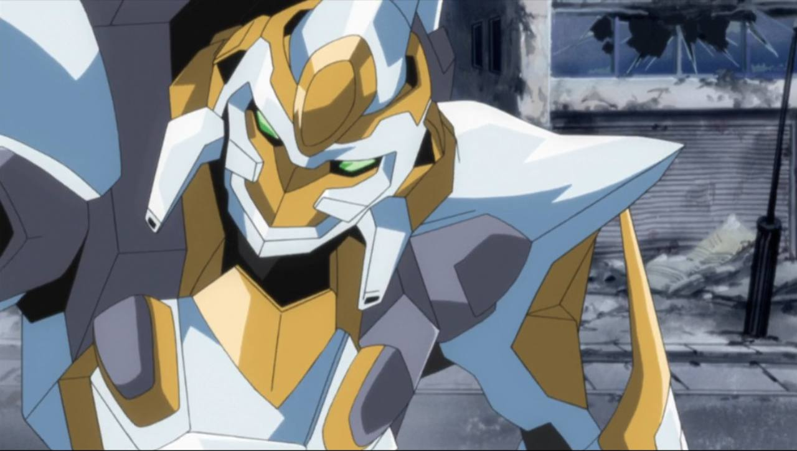

Lelouch abandons the battlefield.

From his personal perspective, the decision is understandable.

Nunnally is the person he has spent years trying to protect. His rebellion began partly because he wanted to create a world where she could live peacefully.

But from the Black Knights' perspective, the situation is catastrophic.

Their commander disappears during a decisive military operation.

The soldiers who trusted Zero's judgment are left fighting without the person responsible for coordinating the larger strategy.

This isn't merely a tactical mistake.

It's the moment when Lelouch's private motivations become incompatible with the obligations he has voluntarily accepted.

He wants the Black Knights to trust him with their lives.

But when forced to choose between their collective struggle and his personal objective, he chooses Nunnally.

That doesn't make him incapable of love.

Quite the opposite.

It shows how deeply he loves her.

But it also reveals a serious limitation in his leadership.

**Lelouch can inspire people to sacrifice everything for a cause that he himself is not always prepared to place above his personal relationships.**

And that's a contradiction he cannot resolve through intelligence alone.

## Zero Is Not Lelouch's Private Possession

There's a distinction that becomes increasingly important throughout the series.

Lelouch created Zero.

But he didn't create the Japanese people's desire for liberation.

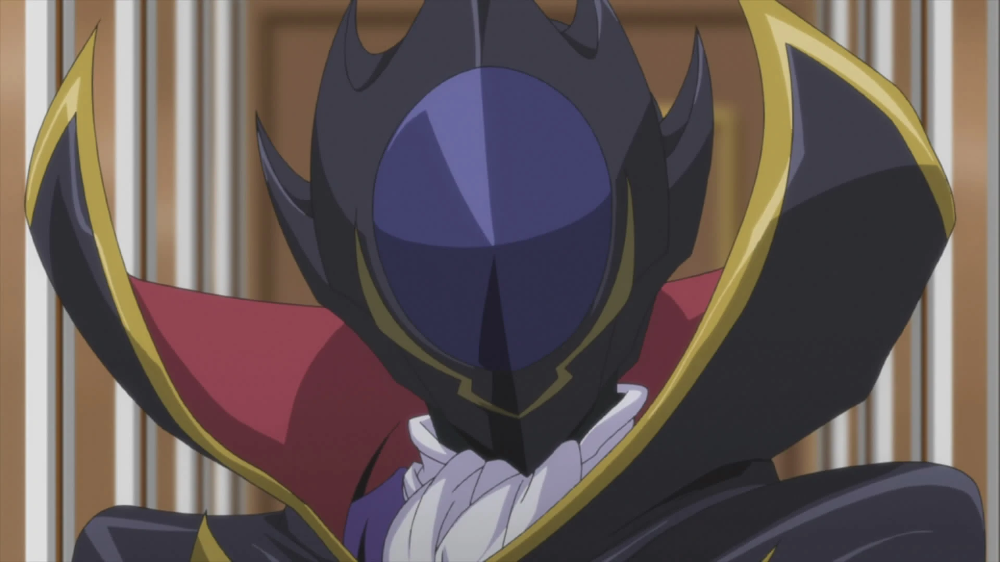

The resistance existed before he arrived.

Its members had already experienced oppression, lost loved ones, and developed reasons to fight Britannia.

Zero gives their struggle direction and military effectiveness.

He doesn't invent its moral foundation.

That means Lelouch's relationship with the Black Knights is fundamentally different from his relationship with Nunnally.

Nunnally is his sister.

The Black Knights are a political organization composed of people with independent objectives.

Their loyalty to Zero isn't a personal promise to support every decision Lelouch makes.

It's an expression of confidence that he will advance their cause.

And that confidence comes with responsibilities.

The Black Rebellion exposes how fragile an organization becomes when so much of its effectiveness depends on one person's presence.

Lelouch has built a movement around his strategic brilliance.

But he hasn't built enough independence into its leadership to make his disappearance survivable.

There's a painful irony here.

The same centralization that makes Zero extraordinarily effective also makes the Black Knights vulnerable when he stops functioning as their commander.

He has made himself indispensable.

And then he leaves.

## Suzaku: The Man Who Refuses to Become Lelouch

Suzaku's confrontation with Lelouch is one of the most important moments in their relationship.

For much of the first season, their disagreement appears to be political.

Lelouch believes Britannia must be overthrown.

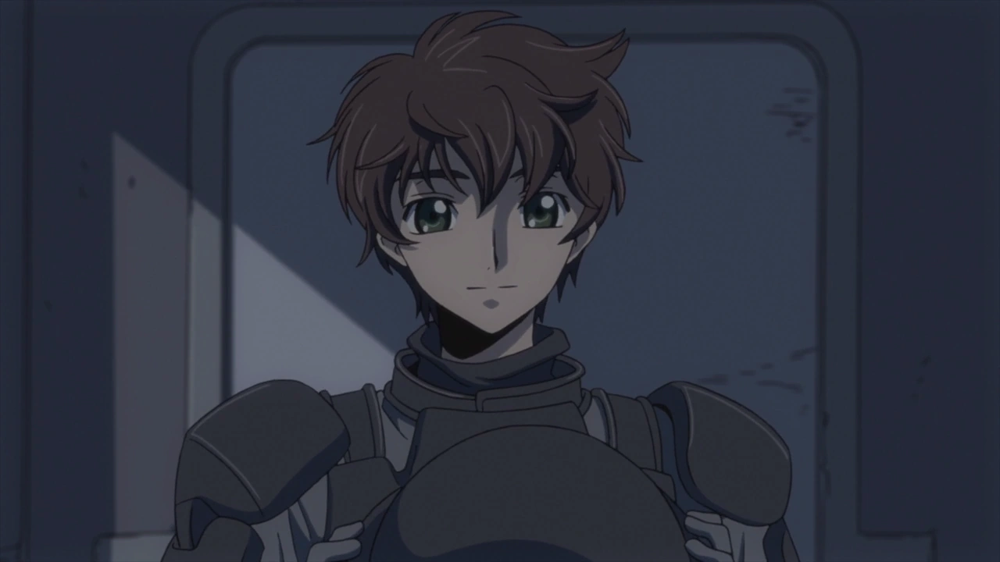

Suzaku believes it can be changed from within.

Lelouch is willing to use morally questionable methods to achieve his goals.

Suzaku insists that the means matter.

But after Euphemia's death, the conflict becomes intensely personal.

Suzaku believes Zero is responsible for the destruction of someone he loved and for the collapse of a peaceful political possibility.

And Lelouch really is responsible for unleashing the catastrophe, even though the original Geass command was accidental.

That distinction between intention and consequence is essential.

Suzaku doesn't have access to the complete circumstances of Euphemia's tragedy.

He sees the result.

And the result is horrifying.

When Suzaku finally confronts Lelouch, the ideological argument between them is overwhelmed by grief, anger, and betrayal.

The boy who once killed his father to prevent further bloodshed now faces his childhood friend, who has become responsible for another catastrophe.

Their conflict is no longer simply about which political strategy is correct.

It's about whether either of them can live with the consequences of the choices they've made.

## Suzaku's Morality and the Burden of Guilt

I've become increasingly interested in the possibility that Suzaku's moral philosophy is partly a response to killing his father.

Suzaku believes that achieving a good outcome through unacceptable methods is fundamentally wrong.

But he has already committed precisely that kind of act.

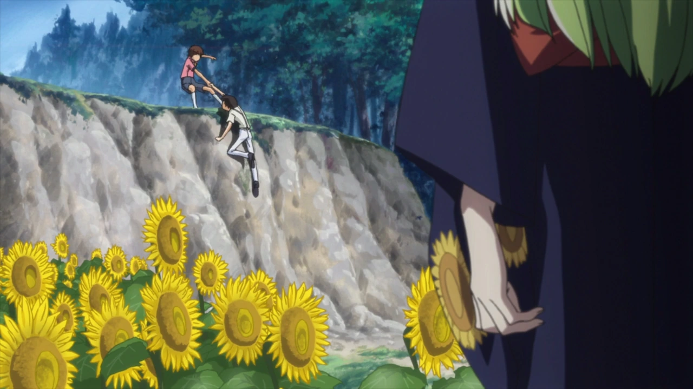

He killed his father because he believed it would end Japan's resistance and prevent additional deaths.

He chose a terrible means to achieve what he considered a necessary outcome.

His later insistence on morally acceptable methods can therefore be interpreted as an attempt to reject the person he once was.

This doesn't mean his compassion is fake.

Suzaku genuinely wants to protect people.

He is willing to put himself in danger for others.

He believes that suffering matters.

But his moral rigidity may also be a way of coping with guilt.

Every time he condemns Lelouch for sacrificing people to achieve an objective, he is also condemning the reasoning that led him to kill his father.

And this makes his decision to surrender Lelouch to the Emperor especially complicated.

Suzaku isn't simply delivering a criminal to justice.

He's using his former friend as a means of advancing his position within Britannia.

The Emperor's interest in Suzaku is connected to the fact that he has brought Lelouch before him.

Suzaku's actions therefore serve both a personal and an institutional purpose.

He wants to stop Zero.

He wants to pursue his own ambitions within Britannia.

And he is willing to sacrifice his friendship with Lelouch to do so.

The boundary between principled action and personal vengeance becomes increasingly difficult to identify.

## The Emperor's Punishment: Destroying Identity Rather Than the Body

One of the most disturbing developments in R2 is the revelation that Lelouch's memories have been altered.

The Emperor doesn't simply imprison or execute him.

He rewrites his understanding of his own life.

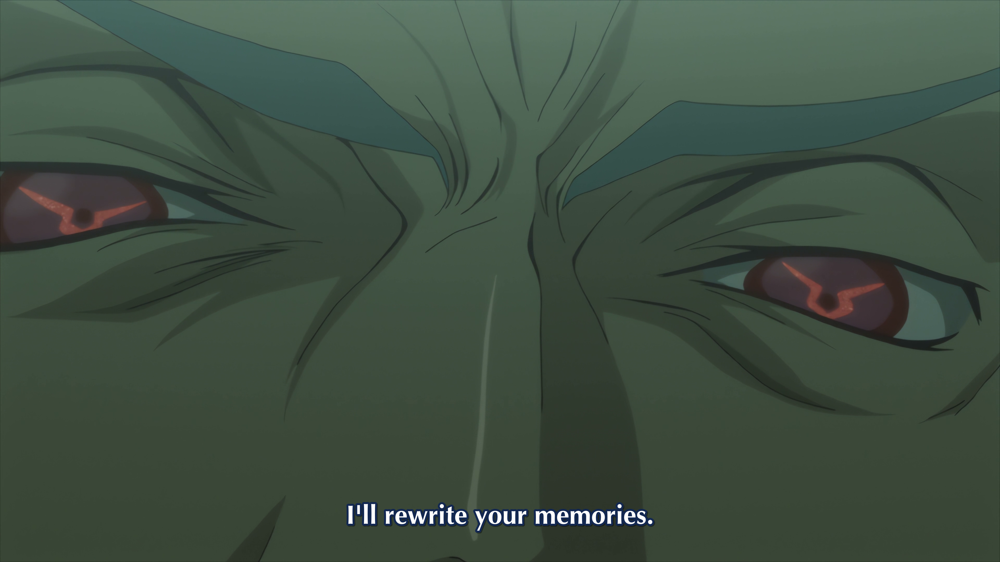

Nunnally is removed from his memories.

Rolo is inserted into the role of his younger brother.

The world Lelouch believes he inhabits is constructed around a false personal history.

This is a particularly appropriate punishment for Lelouch.

His greatest weapon is the ability to control other people's minds through Geass.

Now he experiences the consequences of someone exercising an even more invasive form of control over him.

The irony is almost cruel.

Lelouch has repeatedly treated memory, perception, and choice as things that can be manipulated to achieve strategic objectives.

The Emperor demonstrates what happens when those same principles are applied to Lelouch himself.

And the result raises a fascinating philosophical question.

**If someone's memories can be rewritten, what happens to their identity?**

Lelouch's intelligence remains.

His personality remains recognizable.

His capacity for attachment and ambition hasn't disappeared.

But the story through which he understands himself has been replaced.

He doesn't know that he is missing something.

He doesn't know that the person he believes to be his brother has been inserted into his life.

He doesn't know that the ordinary existence he's experiencing is built on manipulation.

That is a different kind of horror from physical imprisonment.

A prisoner knows that freedom has been taken away.

Lelouch has been made to believe that he was never imprisoned at all.

## Rolo: A Brother Manufactured by the State

Rolo's introduction is one of the most unsettling aspects of R2.

At first, he appears to be Lelouch's younger brother.

He shares his home, attends school, and occupies the emotional position that Nunnally once held.

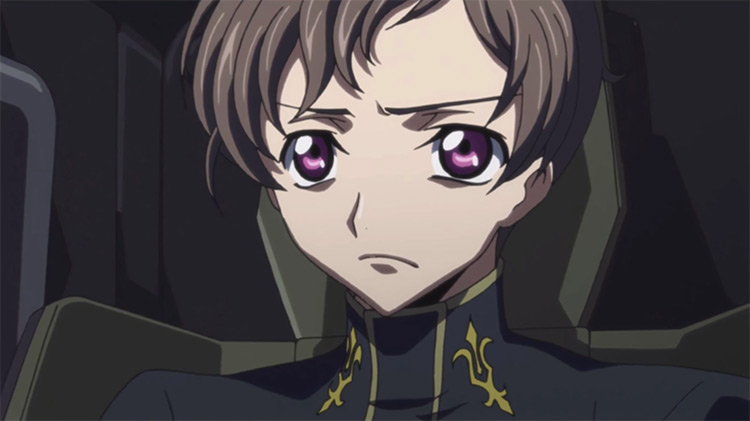

But that relationship has been manufactured.

Rolo's presence is part of the system designed to control Lelouch.

And yet the relationship becomes more complicated than a simple deception.

Rolo is not merely an interchangeable agent.

He has his own attachments, insecurities, and desires.

His possessiveness toward Lelouch suggests that the emotional significance of their relationship is not necessarily identical for both of them.

For Lelouch, Rolo is an obstacle and a potential resource.

For Rolo, the brotherly relationship appears to offer something he values personally.

This creates an uncomfortable asymmetry.

Lelouch knows the relationship is false and begins manipulating it.

Rolo, despite his own deception, is emotionally invested in preserving it.

Both are using the idea of brotherhood for different purposes.

And this is precisely what makes their interactions psychologically interesting.

A relationship can begin as a lie and still produce genuine feelings.

But the existence of genuine feelings doesn't automatically make the relationship healthy or morally defensible.

Rolo's attachment doesn't erase the fact that he has participated in controlling Lelouch's life.

And Lelouch's understandable desire to recover Nunnally doesn't erase the manipulative way he handles Rolo.

The situation is morally uncomfortable because both characters are capable of treating the other as an instrument while also becoming emotionally entangled.

## The False Brother and the Real Sister

Rolo and Nunnally occupy the same familial position in Lelouch's life, but they represent radically different relationships.

Nunnally is central to Lelouch's original identity.

His desire to protect her motivates much of his rebellion.

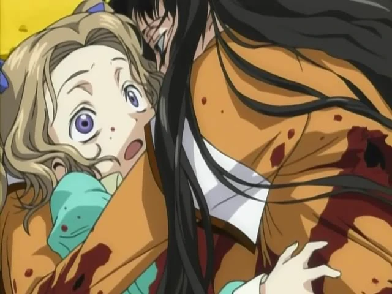

Rolo is part of the artificial identity imposed on him by the Emperor.

But Rolo isn't simply an object.

He has his own experience of their relationship.

And that creates a difficult question.

Does the fact that a relationship was artificially created mean that every feeling within it is artificial?

Not necessarily.

Human attachment doesn't always respect the circumstances under which it develops.

Someone can genuinely love a person who is deceiving them.

Someone can develop an emotional dependency on a relationship that was never equal.

And someone can mistake possession for affection.

Rolo's relationship with Lelouch contains the possibility of all these contradictions.

The most interesting part isn't merely that Rolo is a fake brother.

It's that the role of brother may mean something real to him.

And that makes Lelouch's manipulation of him more disturbing than it would be if Rolo were simply a mindless enemy agent.

## Geass and the Destruction of Autonomy

The Emperor's manipulation of Lelouch's memories also forces us to reconsider Geass itself.

Throughout the series, Lelouch has used his power to compel other people to act against their own judgment.

Sometimes the results appear beneficial.

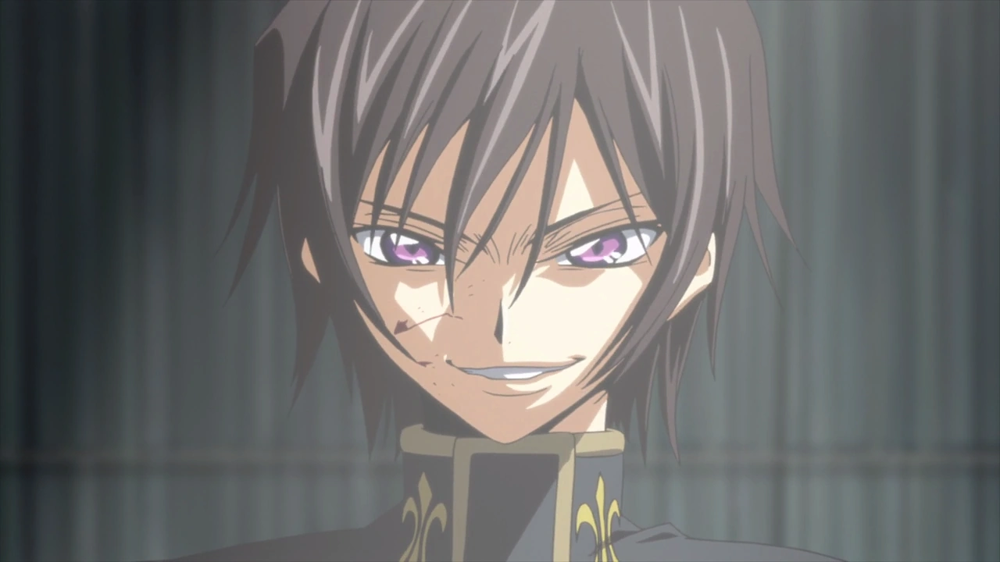

Sometimes they are strategically necessary.

Sometimes they are horrifying.

But the underlying mechanism remains the same.

One person imposes a decision on another.

The victim's autonomy is overridden.

R2 makes that violation personal by placing Lelouch on the receiving end.

He discovers that even his own understanding of his childhood and family can be manipulated.

This doesn't mean every use of Geass is morally identical.

Intentions and consequences still matter.

But the power itself creates an extraordinary imbalance between people.

It allows the user to bypass consent.

And the more useful that ability becomes, the easier it is to rationalize its use.

Lelouch is particularly vulnerable to this temptation because his strategic intelligence encourages him to see control as a solution.

When someone refuses to cooperate, Geass can eliminate the problem.

When someone possesses dangerous information, Geass can alter their behavior.

When an opponent cannot be defeated through ordinary means, Geass offers an alternative.

But every successful use reinforces the idea that another person's independent will is an obstacle to be managed.

The Emperor's treatment of Lelouch exposes the horror of that logic.

## Nunnally Returns: The Goal Becomes the Obstacle

R2 episode 6 creates one of the most fascinating contradictions in Lelouch's entire rebellion.

Nunnally becomes the governor of Area 11.

The person Lelouch wanted to protect is now participating in the political system he wants to overthrow.

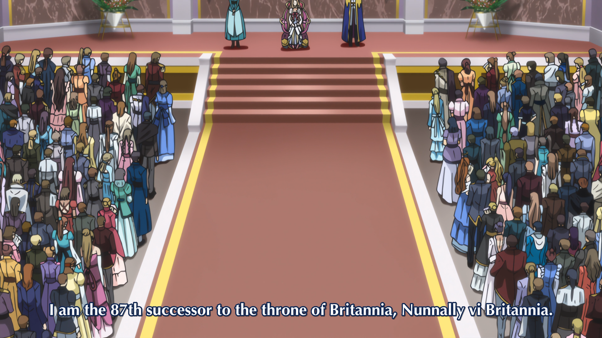

And she is doing so with intentions that resemble Euphemia's.

She wants to improve the lives of the Japanese.

She wants to revive the possibility of peaceful coexistence.

She wants to use her position to help people.

This creates an extraordinary problem for Lelouch.

His revolution was supposed to create a world where Nunnally could live happily.

But Nunnally is now attempting to improve that world through Britannia's institutions.

If Lelouch continues his rebellion without reconsidering its consequences, he risks undermining the very person he claims to be fighting for.

And unlike an enemy commander, Nunnally cannot simply be dismissed as someone whose ambitions are incompatible with justice.

Her compassion is genuine.

Her intentions matter.

She is not merely a passive symbol of Lelouch's objectives.

She is a person with her own political choices.

This is the moment when Lelouch's tendency to decide what's best for others becomes impossible to ignore.

He wants to protect Nunnally.

But does protecting her mean allowing her to make decisions he disagrees with?

Or does he believe that his superior understanding of Britannia gives him the right to determine her future?

The distinction between love and control becomes increasingly important.

## The Special Zone Returns

Nunnally's decision to revive the Special Zone creates a direct connection to Euphemia.

The original proposal was politically dangerous to Zero because it offered the Japanese an alternative to continued rebellion.

Now Nunnally is pursuing a similar approach.

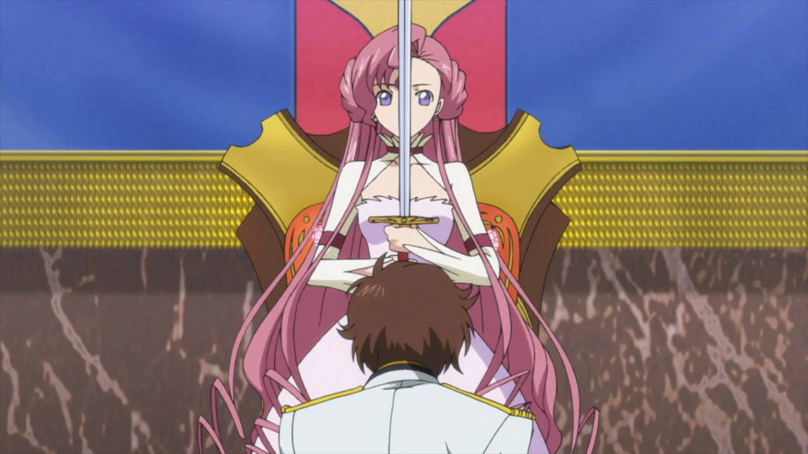

And Lelouch faces a problem that cannot be solved simply by declaring Britannia irredeemable.

The Special Zone may be limited.

It may remain dependent on imperial authority.

It may fail to provide genuine sovereignty.

But it is also an attempt to reduce suffering.

That matters.

Lelouch's revolutionary objectives are not automatically more legitimate merely because they are more ambitious.

If the Japanese can obtain meaningful improvements through reform, he must confront the possibility that his personal war against Britannia is not identical to their immediate interests.

The central political question becomes:

**Is Zero fighting for the Japanese, or is he using the Japanese struggle to fight Britannia?**

The answer is not necessarily one or the other.

His commitment to the Japanese cause has developed throughout the series.

But Nunnally's appointment forces him to recognize that his motivations can conflict.

And that recognition is psychologically devastating.

## Lelouch's Breakdown: What Happens When the Goal Disappears?

R2 episode 7 is one of the most important episodes for understanding Lelouch.

Nunnally's new position leaves him questioning the purpose of his rebellion.

He has spent years constructing his identity around protecting her.

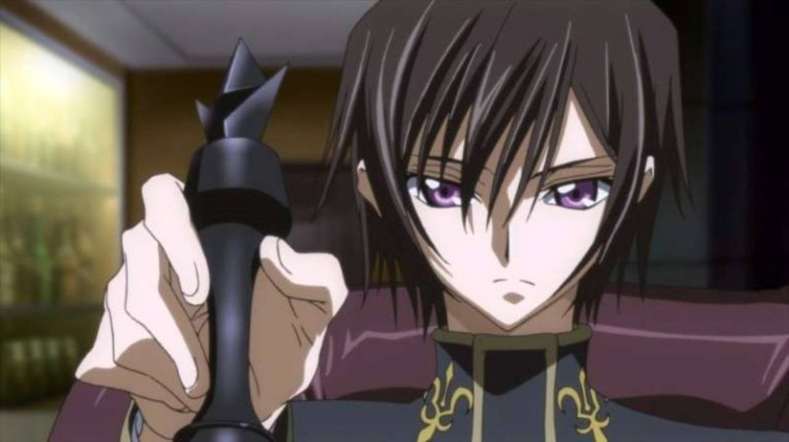

He has sacrificed relationships, endangered himself, and committed morally questionable acts in pursuit of that objective.

Now the person he wants to protect is attempting to build a better world through the very empire he wants to destroy.

For a moment, Lelouch seems unable to imagine what his life means without his original mission.

This is more than disappointment.

It's a crisis of identity.

He hasn't simply lost a strategic objective.

He's lost the explanation he has been using to justify his entire existence.

And that's why his reaction is so revealing.

A person who genuinely understands his own motivations should be able to distinguish between the different reasons he acts.

Lelouch struggles because he has fused them together.

Protecting Nunnally.

Destroying Britannia.

Defeating the Emperor.

Leading the Black Knights.

Proving himself.

These have become parts of one enormous personal narrative.

When Nunnally's situation changes, the narrative begins to collapse.

And Lelouch doesn't immediately know what remains.

## Shirley: The Person Who Doesn't Need Lelouch to Be Zero

Shirley's importance in R2 episode 7 is easy to underestimate.

She doesn't solve Lelouch's political problems.

She doesn't provide a brilliant military strategy.

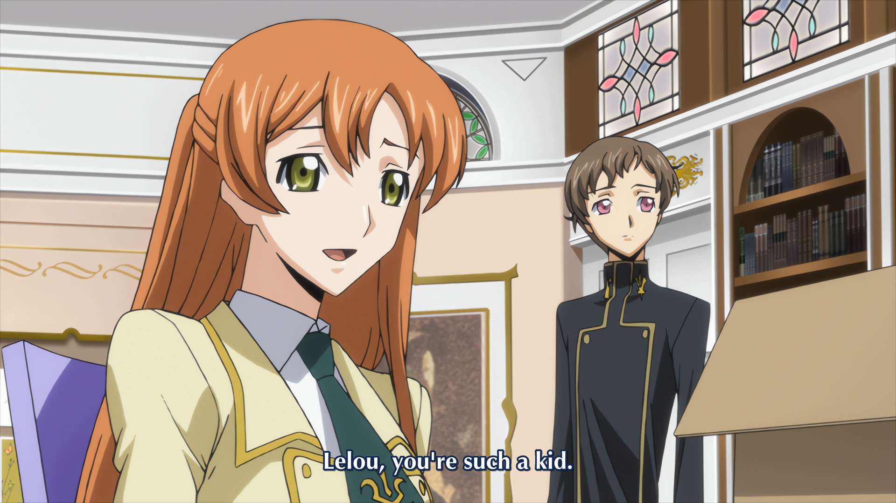

She doesn't explain how to defeat Britannia.

Instead, she helps him recognize something much more fundamental.

His life can have meaning beyond the original purpose of his rebellion.

Lelouch has spent so much time defining himself through what he must accomplish that he struggles to recognize the value of simply continuing to live.

Shirley approaches him from a different emotional perspective.

She cares about Lelouch as a person.

Not because he is Zero.

Not because he can defeat Britannia.

Not because he has a revolutionary mission.

Her affection isn't dependent on his strategic achievements.

And that's important because Lelouch's relationship with the Emperor has left him with an enormous need to prove himself.

He wants to demonstrate that the father who discarded him was wrong.

He wants to prove that the powerless prince can overturn the empire.

He wants to show that his intelligence can compensate for everything he lost.

Shirley's presence challenges that entire framework.

**Lelouch doesn't need to defeat Britannia to deserve affection.**

He doesn't need to become an extraordinary historical figure to justify his existence.

He is allowed to be a person.

And for someone who has built his identity around an impossible mission, that is a surprisingly radical idea.

## The Black Knights Become More Than a Means to an End

The conclusion of episode 7 marks an important development in Lelouch's understanding of his rebellion.

He begins to recognize that the Black Knights have reasons to fight that exist independently of Nunnally.

Their struggle matters even if his original personal motivation has become complicated.

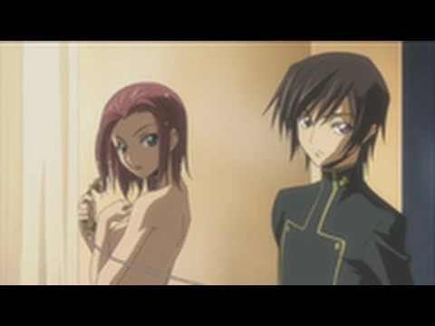

This doesn't mean Lelouch suddenly becomes a perfectly selfless leader.

He still has ambitions.

He still wants to challenge Britannia.

He still relies on secrecy and manipulation.

But the distinction between his personal objectives and the organization's political purpose becomes harder for him to ignore.

The Black Knights are not simply tools for creating Nunnally's ideal world.

They are people who have entrusted Zero with their hopes.

And that trust creates obligations.

Lelouch can no longer convincingly pretend that abandoning the rebellion would affect only him.

His decisions have become part of other people's lives.

That is what it means to become a political leader rather than merely a brilliant individual pursuing revenge.

Leadership requires accepting that the cause can become larger than the person who initially gave it direction.

## The Problem With Extraordinary People

One of the recurring themes in _Code Geass_ is the danger of believing that extraordinary ability creates extraordinary moral authority.

Lelouch is exceptionally intelligent.

Suzaku is an exceptional pilot.

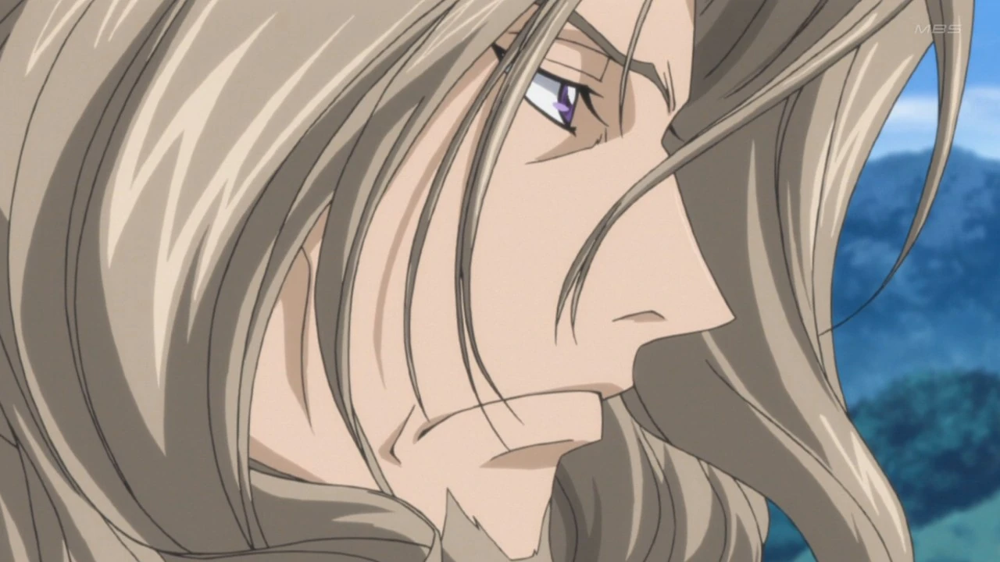

The Emperor possesses extraordinary political and supernatural power.

But none of these abilities automatically gives their possessors a superior understanding of what other people need.

Lelouch's intelligence allows him to identify effective strategies.

It doesn't automatically justify his objectives.

Suzaku's courage allows him to protect people.

It doesn't automatically validate Britannia's institutions.

The Emperor's power allows him to alter reality as others perceive it.

It doesn't make that manipulation morally acceptable.

This distinction is crucial.

Being capable of achieving something is not the same as having the right to impose it.

And Lelouch's development depends partly on whether he can learn that lesson.

## The Mask Becomes a Prison

Zero initially gives Lelouch freedom.

The mask allows him to escape the limitations of his ordinary identity.

As Lelouch Lamperouge, he is a student living under Britannian surveillance.

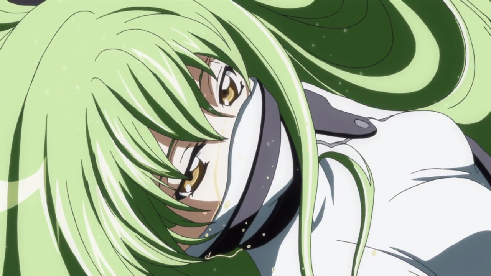

As Zero, he can challenge generals, inspire revolutionaries, and confront the empire that destroyed his childhood.

But the more successful Zero becomes, the more the identity develops obligations of its own.

People depend on him.

People believe in him.

People sacrifice their lives because they trust what Zero represents.

And Lelouch discovers that he cannot simply remove the mask whenever his personal circumstances become unbearable.

The symbol has become larger than the person wearing it.

That is the central tragedy of these episodes.

Lelouch created Zero to achieve his private goals.

Now Zero's existence requires him to consider goals beyond himself.

The mask that once allowed him to control his circumstances has become a responsibility he cannot easily escape.

## A Different Kind of Victory

The ending of R2 episode 7 isn't a conventional victory.

Lelouch hasn't defeated the Emperor.

He hasn't liberated Japan.

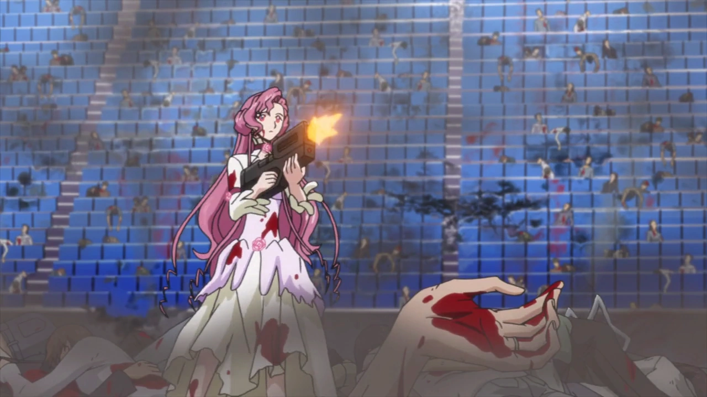

He hasn't resolved his conflict with Suzaku.

He hasn't solved the contradictions surrounding Nunnally.

And he certainly hasn't learned how to communicate honestly with everyone around him.

But he has achieved something important.

He has begun separating the value of his life from the success of his original mission.

He can recognize that other people have reasons to fight.

He can acknowledge that the revolution has developed meaning beyond his personal revenge.

And he can continue moving forward without pretending that every decision is simply something he does for Nunnally.

That doesn't eliminate his contradictions.

It makes him more aware of them.

For a protagonist whose greatest weakness is the belief that he can control everything, recognizing that other people have independent purposes is an important development.

Lelouch remains a genius.

He remains theatrical, manipulative, and frequently infuriating.

He still believes that he can outthink almost any opponent.

But he is beginning to understand that the people around him aren't merely pieces on his chessboard.

They have lives that continue when he isn't watching.

They have motivations that don't originate with him.

And they have placed their trust in a symbol that now carries responsibilities he cannot simply discard.

**Lelouch created Zero because he wanted to change the world for someone he loved.**

**Now he must confront the possibility that changing the world means caring about people beyond that original purpose.**

And that is a far more difficult challenge than winning a game of chess.
