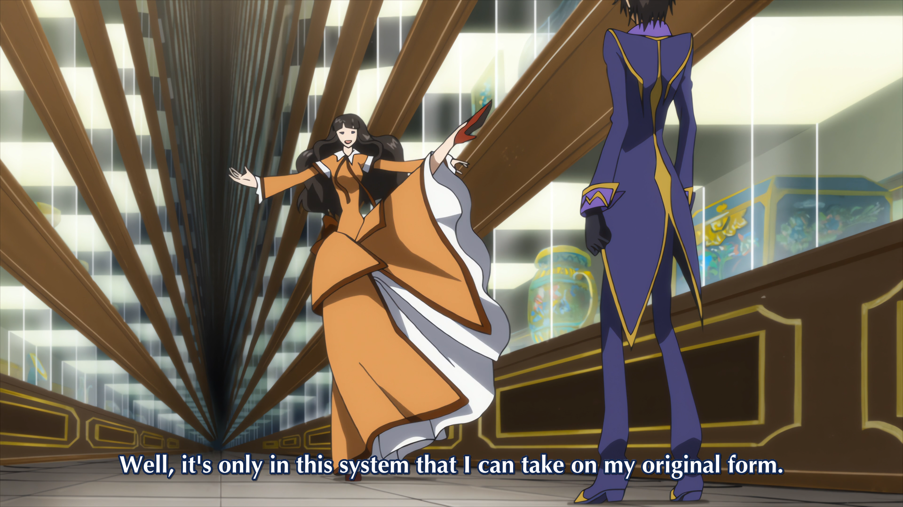
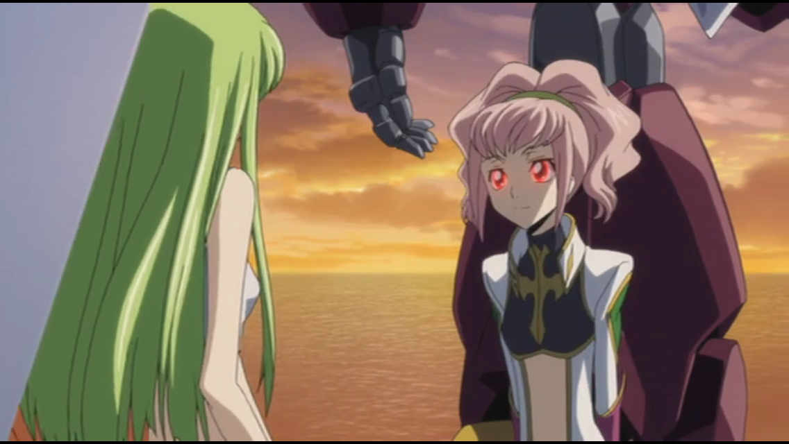
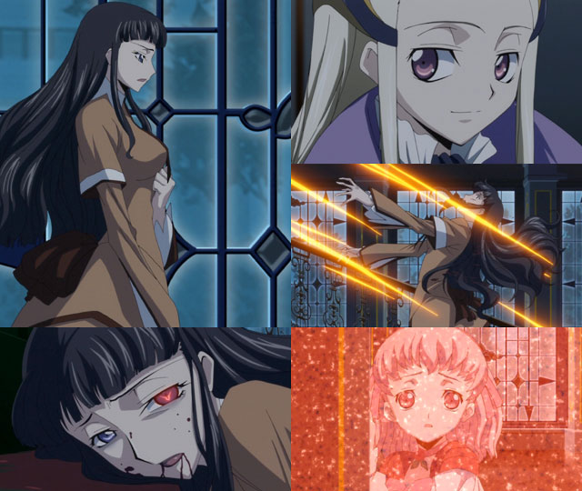
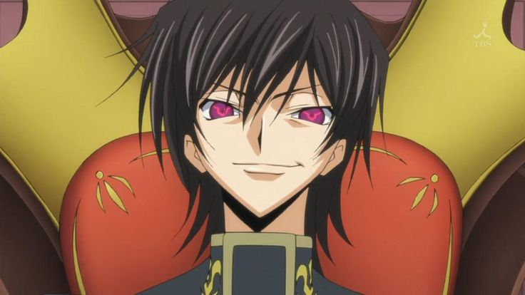
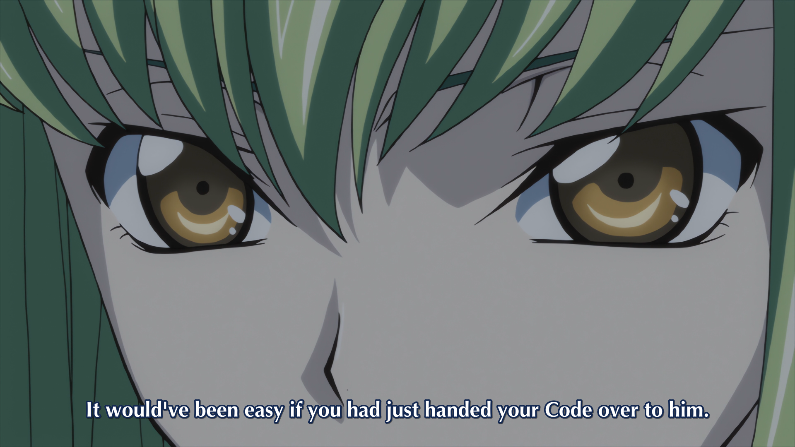
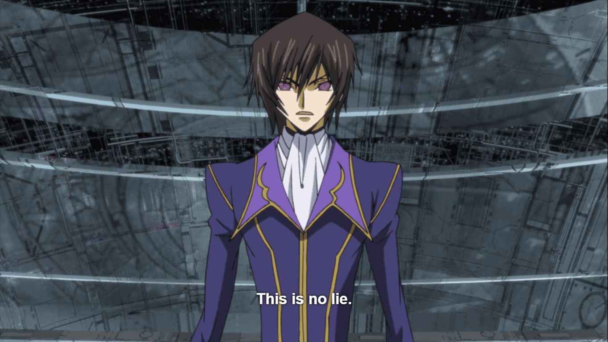
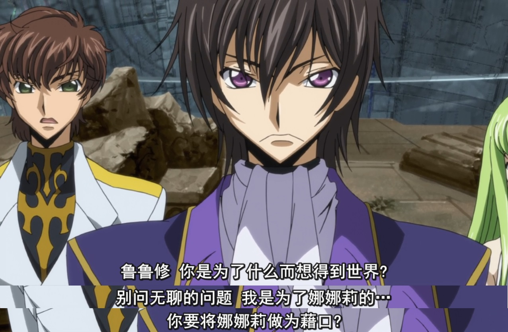
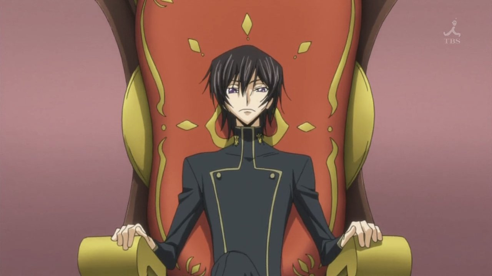
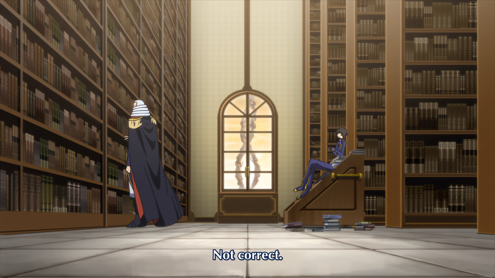

_R2 Episodes 20–21. Spoilers through R2 Episode 21 only._

# The World Without Lies

What if the solution to human suffering were to eliminate the barriers between people's minds?

What if misunderstanding, deception, loneliness, and conflict could be overcome by removing the separation between individual consciousnesses?

At first glance, that might sound like an extraordinary promise.

But _Code Geass_ asks a much more disturbing question.

**What happens when someone decides that humanity must be saved from its own individuality?**

R2 episodes 20 and 21 transform Lelouch's conflict with the Emperor from a personal struggle into a philosophical confrontation.

And the most fascinating part is that the Emperor's vision is not presented merely as a desire for conventional political domination.

He claims to be pursuing something much larger.

The question is whether that vision respects the people it supposedly exists to help.

## The Emperor's Rebellion Against Reality

The Emperor's public ideology celebrates strength.

Britannia's political system rewards conquest, hierarchy, and domination.

For much of the series, Lelouch interprets his father through that ideology.

The Emperor is the man who discarded his children.

He is the ruler of an oppressive empire.

He represents the system that Lelouch wants to destroy.

But the revelations surrounding the Ragnarok Connection complicate this understanding.

The Emperor's ambitions extend beyond political authority.

He wants to transform the fundamental conditions of human existence.

His goal is connected to overcoming the separation, deception, and suffering that characterize individual human lives.

And that creates a striking contradiction.

The ruler who publicly glorifies competition and domination privately pursues a world in which the distinctions between individual minds would be fundamentally altered.

His public politics and his private project are not straightforward expressions of the same philosophy.

That doesn't make his political cruelty irrelevant.

It makes the gap between his stated ideals and his actual treatment of people even more important.

## Marianne: The Mother Lelouch Thought He Understood

Marianne's return fundamentally changes Lelouch's understanding of his childhood.

For years, he has built his identity around the belief that his mother was murdered and that his father abandoned him and Nunnally.

Those experiences shaped his hatred of Britannia.

They helped define his rebellion.

But Marianne's involvement in the Emperor's plans reveals that Lelouch's understanding of his family was incomplete.

And what makes the revelation so disturbing is not merely that Marianne survived in an unusual form.

It's that her priorities do not align with the image of the mother Lelouch has preserved.

He remembers someone whose loss devastated his childhood.

But the person he confronts is committed to a project that places an abstract vision of humanity above the ordinary emotional needs of her children.

That difference is painful.

Lelouch hasn't simply discovered new information.

He has discovered that the emotional foundation of his rebellion was built partly around an incomplete understanding of the people he loved.

## Anya: The Person Whose Life Was Used

Marianne's presence within Anya raises an ethical issue that deserves attention.

Anya is not merely a convenient location for another character's consciousness.

She is a person.

She has her own life, experiences, and identity.

And her mind has been used for purposes she did not meaningfully choose.

The supernatural circumstances don't eliminate the moral problem.

They intensify it.

Anya's autonomy has been compromised by people pursuing objectives far beyond her understanding.

This is another example of _Code Geass_ examining the danger of treating individuals as instruments.

The Emperor and Marianne claim to pursue an extraordinary future for humanity.

Yet their methods involve overriding the independence of actual human beings.

The contradiction is difficult to ignore.

**A plan to save humanity becomes morally suspect when it requires disregarding the humanity of the people used to accomplish it.**

## Nunnally's Smile: The Detail Marianne Doesn't Understand

One of the most revealing moments is Marianne's confusion about Nunnally's smile.

It's a small detail.

But psychologically, it says an enormous amount.

Nunnally's smile matters to Lelouch because it represents a form of care that exists between individuals.

It isn't simply a signal that she is happy.

It's connected to her relationships, her efforts to reassure others, and the way she responds to the people around her.

Marianne's failure to understand that emotional significance exposes a gap between her abstract philosophy and her understanding of actual human connection.

She can discuss humanity on an enormous scale.

But she struggles to recognize what a single person's expression means within a relationship.

And that is devastating.

Because it suggests that the Emperor and Marianne are so focused on overcoming the limitations of human existence that they have lost sight of the value of the experiences they want to transform.

## The Difference Between Understanding and Erasing

Human beings misunderstand one another.

We conceal information.

We lie.

We misinterpret intentions.

We hurt people without realizing what we're doing.

And sometimes we deliberately hurt people we claim to love.

The Emperor's project appears to offer an escape from those limitations.

But there is a crucial distinction between helping people understand one another and eliminating the separateness that makes individual relationships possible.

Understanding requires recognizing that another person has a mind independent of your own.

It involves uncertainty.

You cannot completely possess another person's experiences.

You have to listen, interpret, and sometimes accept that you were wrong.

A world without those boundaries might eliminate certain kinds of misunderstanding.

But it would also threaten the conditions that make empathy meaningful.

**Empathy matters because another person is not you.**

If individuality disappears, the challenge of understanding someone else may disappear with it.

But so might the meaning of choosing to understand them.

## Lelouch Rejects the World His Parents Want

Lelouch's rejection of the Emperor and Marianne is one of the most important decisions he has made.

Throughout the series, he has tried to control people and events through superior intelligence.

He has used Geass to override choices.

He has manipulated allies and enemies.

He has often treated uncertainty as a problem to be eliminated.

Yet he rejects his parents' attempt to impose a supposedly ideal future on humanity.

Why?

Because their vision sacrifices the independent lives of real people for an abstract conception of happiness.

They want to overcome suffering by transforming the nature of human existence.

Lelouch insists on the importance of the future people have not yet chosen.

That distinction matters.

The Emperor and Marianne look backward toward the suffering and deception they want to overcome.

Lelouch chooses the possibility of a future that remains uncertain.

And for someone who has spent so much time trying to control outcomes, that is a remarkable philosophical development.

It doesn't erase his previous actions.

It doesn't suddenly make him a defender of perfect individual autonomy.

But it reveals that he recognizes a limit to the authority anyone should possess over humanity's future.

## Suzaku's Changing Morality

Suzaku's behavior has also changed dramatically.

For much of the series, he insisted that achieving a desirable outcome through unacceptable methods was wrong.

His moral identity was built partly around rejecting the reasoning that led him to kill his father.

But his experiences have shattered the simplicity of that position.

Euphemia's death.

His conflict with Lelouch.

FLEIJA.

The enormous suffering produced by choices he could not fully control.

All of these events have placed pressure on his belief that he can preserve his principles simply by refusing certain methods.

The Suzaku we see now appears more willing to accept ruthless action.

And that raises a psychological question.

Was his earlier moral rigidity partly a response to guilt?

Did he construct an identity around being someone who would never again make the decision he made as a child?

If so, the collapse of that identity does not necessarily reveal that his compassion was fake.

It may reveal that compassion and guilt were always intertwined.

The person who wanted to save others and the person capable of terrible decisions were never completely separate.

## ALL HAIL LELOUCH

And then Lelouch becomes Emperor.

WHAT.

The boy who spent the series trying to destroy Britannia now takes control of it.

And Suzaku stands beside him.

The symbolism is extraordinary.

Lelouch's rebellion began with the conviction that the Emperor's political order had to be destroyed.

Now he claims the institution at the center of that order.

But taking power isn't the same as using it justly.

This is where the political questions become especially important.

Will Lelouch dismantle Britannia's imperial hierarchy?

Will occupied peoples gain meaningful self-determination?

Will he demilitarize?

Will his government establish institutions capable of restraining the power of its ruler?

Or will he simply replace one absolute authority with another?

His rejection of his parents' plan demonstrates something about his philosophy.

It doesn't yet tell us what his political rule will look like.

And that distinction matters.

**Opposing tyranny does not automatically make someone a good ruler.**

The real test begins when Lelouch has the authority to decide what comes next.

## The Future Must Belong to Someone

The Emperor and Marianne want to transform humanity according to a vision they consider superior.

Lelouch rejects that vision.

But he now possesses extraordinary political power himself.

The danger is obvious.

He could oppose his parents' coercion while reproducing another form of coercion through his own rule.

The question is whether he understands the difference between creating conditions for a better future and deciding the future on everyone else's behalf.

For the first time, Lelouch has an opportunity to confront that question not merely as a revolutionary but as a ruler.

He has defeated the Emperor.

He has rejected his parents' idealized world.

He has claimed Britannia's throne.

And Suzaku, whose moral philosophy has undergone its own transformation, now stands beside him.

**Lelouch has won the right to change the empire.**

**He has not yet demonstrated that he knows how to give its people control over their own future.**
