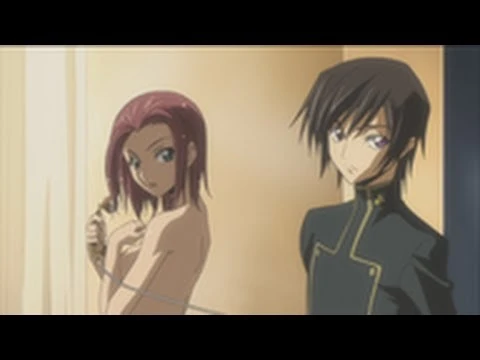
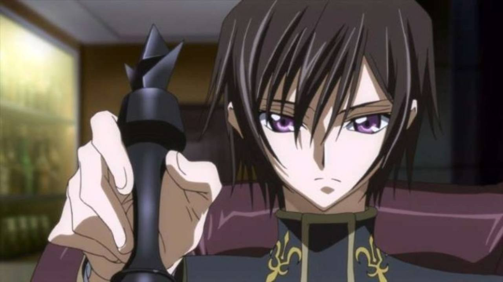
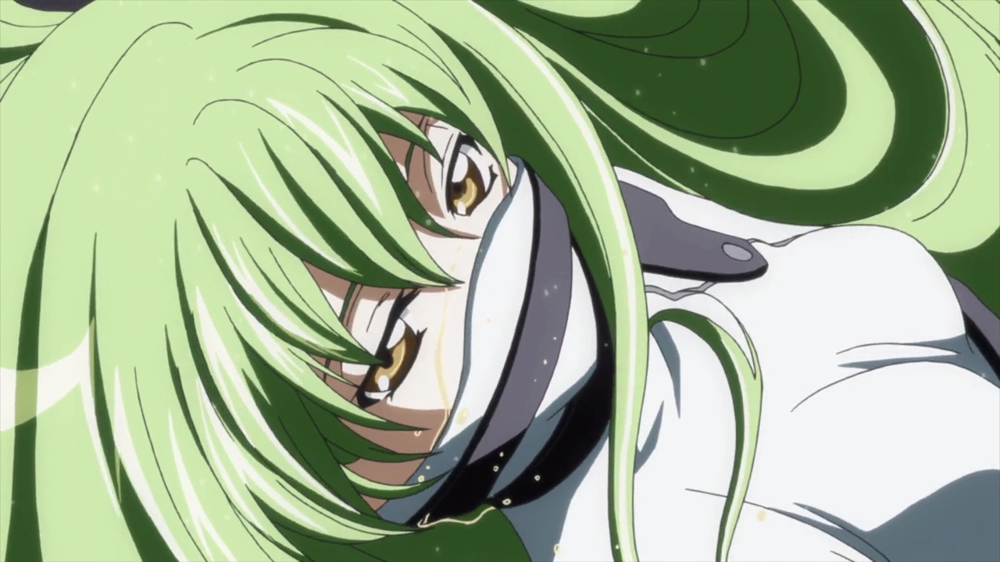
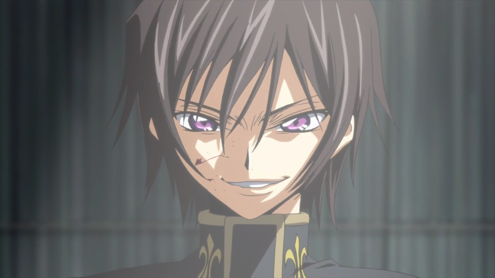
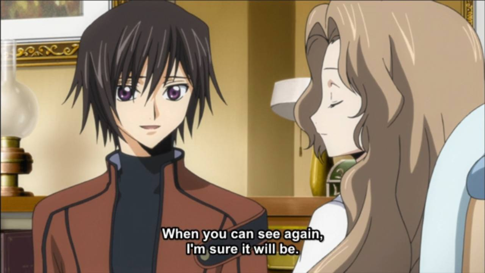
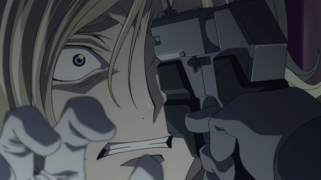
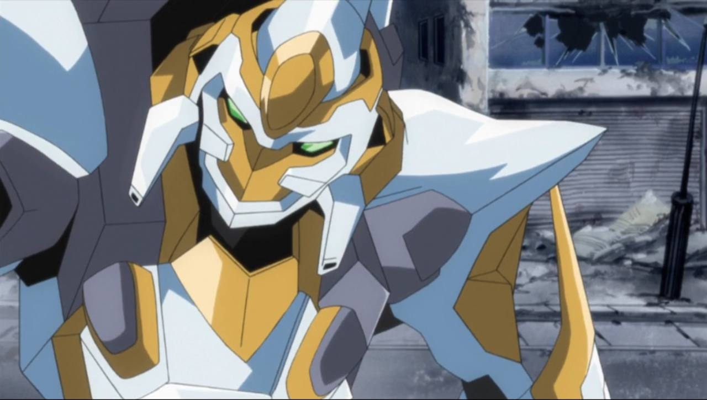
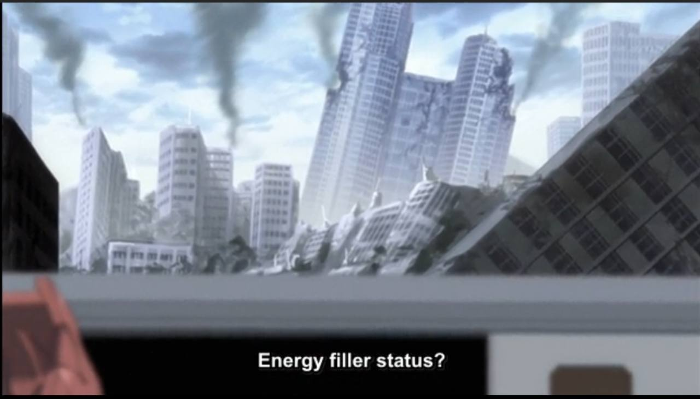
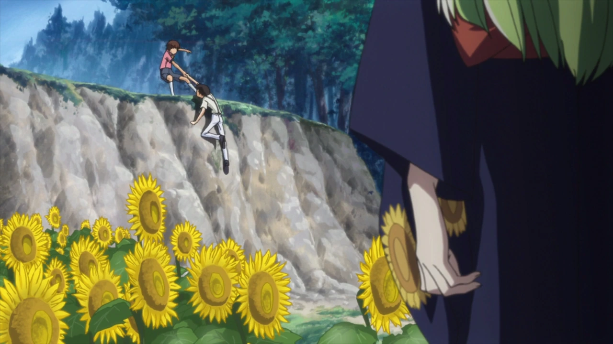

I've watched exactly three episodes of _Code Geass_, and HOLY FK.

Seriously. THREE EPISODES.

After watching _Frieren_ and Pey Talks Anime, I've started paying more attention to _why_ an anime works rather than just whether I enjoyed it. I want to understand how characters are written, how stories communicate their ideas, and why certain scenes have such an impact.

And _Code Geass_ has already given me an absurd amount to think about.

We have political oppression, royal conspiracies, psychological contradictions, military strategy, a mysterious supernatural power, and a protagonist who apparently considers international conflict a perfectly reasonable extracurricular activity.

All within three episodes.

This is an **episode 1–3 impressions post**, not a review of the entire series. I want to preserve what I think _now_, before later revelations change my understanding of the characters.

Because one of the most interesting things about watching a story is seeing how your interpretations evolve.

And right now?

HOLY FK.

## Three Episodes, an Entire Political Nightmare

The pacing is absolutely ridiculous.

In the best possible way.

We're introduced to an occupied Japan, the Britannian Empire, the Elevens, resistance movements, Knightmares, an imperial family, and an unexplained power capable of overriding human free will.

And somehow the series doesn't collapse under the weight of its own exposition.

Instead of pausing the story to explain every institution, _Code Geass_ allows us to understand its world through the consequences of those institutions.

The occupation isn't just a historical fact mentioned in dialogue. We see how it affects the way people live, how soldiers treat civilians, and how the government values different lives.

One detail that particularly stuck with me was the military's reaction to the deaths of eight Britannian soldiers.

Their deaths are acknowledged and mourned.

Meanwhile, an unknown number of Elevens can be killed without receiving anything approaching the same consideration.

That contrast communicates the hierarchy of the empire more effectively than a lengthy speech about discrimination could.

The system doesn't merely distinguish between Britannians and Elevens politically.

It assigns different values to their lives.

And that distinction matters because it gives the conflict an ideological foundation.

The resistance isn't simply fighting because the story needs an enemy faction.

It's fighting against a system that has already decided its members are worth less.

But _Code Geass_ also introduces a complication immediately: the people opposing an oppressive system aren't automatically morally justified in everything they do.

That becomes particularly interesting once Lelouch enters the picture.

## Chess, Geass, and the Illusion of Control

Lelouch's introduction through chess is brilliant.

It tells us an enormous amount about him before we understand his history.

He sees a situation that appears unwinnable, recognizes possibilities that other people have overlooked, and takes control through superior strategic understanding.

But the chess imagery does more than establish intelligence.

It establishes a way of looking at the world.

In chess, pieces have defined functions. They can be moved, sacrificed, protected, or exchanged depending on what the player wants to achieve.

A good move isn't necessarily one that preserves every piece.

It's one that improves your position.

And Lelouch seems remarkably comfortable applying that logic to real conflict.

When he begins directing the resistance fighters, he approaches the battlefield as a collection of positions, opportunities, and predictable responses.

He doesn't need to be physically stronger than his opponents.

He needs to understand how they'll move.

That's an incredibly satisfying approach to tactical action because the victories feel connected to decisions rather than simply to the protagonist possessing a stronger weapon.

Then the story gives him Geass.

And WHAT AN ABSURDLY FITTING POWER.

A boy who already thinks of people as pieces on a chessboard gains the ability to literally command their actions.

Thematically, that's almost too perfect.

But it also introduces a fascinating distinction.

**Being an excellent tactician isn't the same as being an excellent leader.**

A tactician can succeed by predicting and directing behavior.

A leader has to convince people to cooperate, maintain their trust, and create a reason for them to continue following even when a plan fails.

Geass allows Lelouch to bypass the need for persuasion entirely.

He can obtain obedience without agreement.

He can produce the result of loyalty without actually earning loyalty.

And while that's extraordinarily useful in the short term, I wonder whether it might become a weakness.

If Lelouch can always force a solution, what incentive does he have to learn how to persuade someone who genuinely disagrees with him?

The chessboard gives him control over pieces.

But human beings aren't pieces.

They have memories, principles, loyalties, fears, and goals that don't necessarily align with his.

Three episodes in, Lelouch's ability to control a battle is obvious.

His ability to build lasting trust is a much more interesting question.

## Lelouch: Fascinating, but Something Feels Off

Lelouch is already an incredibly entertaining protagonist.

He's intelligent, theatrical, arrogant, observant, and apparently incapable of doing anything without making it look like a dramatic declaration of war.

But what interests me most is the contrast between his different personalities.

Around Nunnally, he's an absolute cinnamon roll.

He's attentive, gentle, and clearly invested in her happiness.

Around most other people, he appears detached or uninterested.

I wouldn't necessarily call him socially incompetent.

He understands social situations well enough to manipulate them.

He just doesn't seem particularly interested in participating sincerely unless the person matters to him.

Nunnally is the obvious exception.

That makes his ruthlessness even more unsettling.

Because the Lelouch who cares so deeply about his sister is also the Lelouch who becomes comfortable ordering people to die remarkably quickly.

And I'm not entirely convinced by that transition yet.

### My Problem With His Sudden Ruthlessness

I understand why Lelouch hates Britannia.

The revelation that he's a prince gives his anger a personal dimension, and his line about living a life of lies since "that day" suggests a much deeper history.

But understanding a character's motivation isn't the same as understanding their psychological transition.

Those are two different things.

A person can have an excellent reason to hate someone without being immediately comfortable killing them.

And Lelouch appears to cross that boundary with surprisingly little hesitation.

The comparison that comes to mind is Light Yagami from _Death Note_.

Light's early experience with the Death Note includes disbelief, experimentation, shock, and rationalization.

We watch him begin constructing a moral framework that allows him to justify what he's doing.

His descent into an obsession with control has a visible psychological process.

Lelouch, by contrast, seems remarkably prepared to use lethal force.

After killing Clovis, his emotional response feels relatively brief considering the enormity of what he's done.

Clovis isn't simply an enemy commander.

He's Lelouch's half-brother.

That should be an extraordinary psychological event, even for someone who despises the imperial family.

Now, I'm not arguing that Lelouch needs to react like an ordinary teenager.

He's clearly not ordinary.

And there's obviously information about his past that we haven't received yet.

But I think the show has delayed an important emotional bridge.

**I understand why Lelouch wants to fight. I'm less convinced that I understand how he became someone capable of fighting this way.**

That's a characterization criticism, not a rejection of the character.

In fact, I find him more interesting because I'm not completely comfortable with him.

And perhaps later episodes will recontextualize everything.

But I don't want to give the writing credit for explanations I haven't actually seen yet.

For now, the political motivation is convincing.

The psychological transition feels abrupt.

Both observations can be true.

## Glasgow, Sutherland, Lancelot: ABSOLUTE CINEMA

THE KNIGHTMARE ACTION IS SO GOOD.

I love how clearly the series communicates the difference between the machines.

The Glasgow, the Sutherland, and the Lancelot don't simply look different.

They _move_ differently.

The Lancelot's speed and agility make its technological superiority immediately obvious.

You don't need a lecture about specifications or engineering to understand that Suzaku is piloting something extraordinary.

You can feel the difference in how it fights.

And that makes the action much more satisfying.

The technology isn't just decorative worldbuilding.

It changes the tactical possibilities available to the characters.

Lelouch can make excellent strategic decisions, but superior planning doesn't automatically eliminate the threat posed by an overwhelmingly powerful machine.

That's important because it prevents intelligence from becoming a magical solution to every problem.

A strategist still has to operate within the limits of the battlefield.

### The Civilian Who Runs From His Rescuer

One of my favorite details is an Eleven fleeing from the Lancelot even while Suzaku is trying to help.

It's such a small moment, but it communicates something enormous.

We know Suzaku wants to protect people.

The civilian doesn't know Suzaku.

They see a Britannian war machine.

And in their experience, Britannian war machines mean danger.

**Good intentions don't erase the meaning of a symbol.**

Suzaku can be genuinely compassionate while operating a machine associated with an oppressive military.

His personal morality doesn't automatically change how other people experience the institution he represents.

That creates an immediate conflict between his intentions and his position within Britannia.

And it's a far more interesting conflict than simply having one good soldier surrounded by bad soldiers.

## Suzaku and Lelouch: Two Different Ideas of Doing Good

Suzaku initially appears to be someone caught up in events beyond his control.

He's a Japanese soldier serving Britannia, treated as expendable by people who consider him inferior.

Then he's placed in the Lancelot.

Then he becomes entangled in a political accusation.

But through all of that, he demonstrates a stubborn moral backbone.

He refuses an order to kill Lelouch.

He tries to protect civilians.

He takes his responsibilities seriously even when the institution employing him behaves in ways that contradict his values.

There's something almost Naruto-like about that refusal to abandon his principles.

But unlike a straightforward heroic idealist, Suzaku is operating inside an oppressive system.

And that's what makes him interesting.

He wants to do good through an institution that repeatedly does terrible things.

Is it possible to change such a system by working within it?

Or does participating in it inevitably make you complicit?

Three episodes aren't enough to answer that question.

But the contradiction is already there.

Lelouch appears to take the opposite approach.

He rejects the legitimacy of Britannia's authority and is willing to use coercion and violence to challenge it.

Suzaku seems concerned with the morality of the means.

Lelouch seems much more focused on achieving the desired result.

Of course, that's only an initial impression.

We haven't seen enough to establish either character's complete philosophy.

Still, the contrast is fascinating.

**Lelouch wants to challenge an unjust system through morally questionable methods. Suzaku wants to act morally while serving an unjust system.**

Neither position is automatically free of contradiction.

And neither character can be evaluated solely by what he claims to believe.

Their actions matter.

Their circumstances matter.

And the consequences of their decisions matter.

I suspect the relationship between these two will become one of the most interesting parts of the show.

## The Difference Between Winning and Being Right

Something I already appreciate about _Code Geass_ is that its central conflict isn't simply about which side has better intentions.

Britannia's oppression is unmistakable.

But opposing oppression doesn't automatically answer every moral question about how resistance should operate.

Lelouch's intelligence makes him effective.

It doesn't automatically make him right.

Suzaku's compassion makes him sympathetic.

It doesn't automatically justify the institution he serves.

And that's an excellent foundation for character-driven political drama.

It allows us to distinguish between several questions that stories sometimes treat as interchangeable.

Is a character's goal justified?

Are their methods justified?

Are their actions effective?

And do the consequences actually match what they intended?

A character can succeed strategically while failing morally.

They can act with good intentions while reinforcing something harmful.

They can even make a morally defensible decision that produces disastrous consequences.

Those possibilities are what make the characters worth discussing.

And if _Code Geass_ continues exploring those contradictions, I can already see why people have so much to say about it.

## Why I'm Already Hooked

_Code Geass_ is not remotely subtle about wanting to be dramatic.

And I LOVE THAT.

The theatrical dialogue, the chess imagery, the military battles, the political conspiracies, the sudden revelations—

IT'S SO MUCH.

But underneath all that spectacle, there's a surprisingly rich collection of ideas.

The occupation establishes the political stakes.

The Knightmares make differences in military power tangible.

Geass introduces questions about obedience and free will.

Lelouch raises questions about whether intelligence and conviction justify control over others.

Suzaku raises questions about whether good intentions can survive participation in an unjust institution.

And their friendship gives those opposing approaches a personal dimension.

All of that in three episodes.

I still have reservations about Lelouch's emotional characterization.

His ruthlessness feels more immediate than the psychological development we've actually witnessed.

But I don't think loving a show requires pretending every part of it is perfect.

In fact, I think the opposite.

**A story becomes more interesting when you can explain both why something works and why something doesn't quite convince you.**

That's what I want from these impressions.

Not to declare a masterpiece after three episodes.

Not to search for flaws simply to sound critical.

But to pay attention.

To form interpretations, question them, and see how the story changes my understanding.

_Frieren_ made me appreciate the value of small moments and the emotional meaning hidden in ordinary actions.

_Code Geass_, at least so far, is making me think about power, control, ideology, and the contradictions between what people want and what they're willing to do.

Very different approaches.

Both fascinating.

And if this is what the first three episodes have to offer, I genuinely cannot imagine what the rest of the series has planned.

**Current verdict: HOLY FK.**

_Written after episode 3. No spoilers beyond that point._
