_Season 1 through Episode 23 only. No spoilers beyond that point._

Before I talk about the political philosophy, the psychological contradictions, and the absurd amount of chess that happens in this anime, I need to establish something.

Lelouch vi Britannia is an extraordinary protagonist.

Not because he is always right. Not because his plans always work. And certainly not because he is some omniscient mastermind who has already calculated every possible outcome.

He's extraordinary because he genuinely possesses the intelligence to change history while remaining painfully incapable of controlling his own life.

That contradiction is the heart of _Code Geass_.

The anime initially presents Lelouch as someone who can stand outside the world, observe its mechanisms, and manipulate it like a chessboard.

Give him Geass, a mask, and an enemy called Britannia, and the fantasy seems obvious: the genius will defeat the empire by moving everyone else into the correct position.

But the more I watch, the more I realize that Lelouch isn't simply a mastermind who occasionally makes mistakes.

He's a person whose entire understanding of control is flawed.

He can predict military movements, exploit political institutions, and manipulate human behavior with extraordinary precision.

Yet he repeatedly struggles with the simplest requirement of a relationship:

Trusting another person enough to let them understand him.

## The Chessboard Is a Lie

Lelouch loves chess.

And the symbolism is so obvious that it almost becomes a joke.

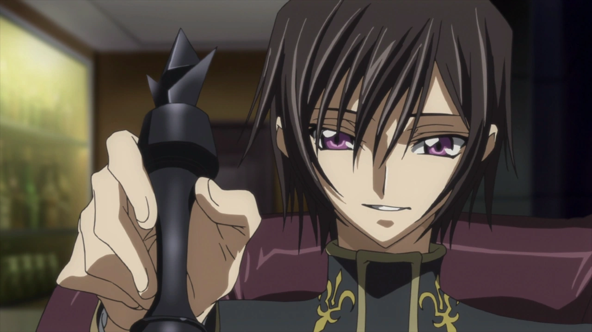

He treats conflicts as games of positioning, information, and sacrifice. Every opponent has weaknesses. Every institution has pressure points. Every person has motivations that can be exploited.

The problem is that people aren't chess pieces.

Chess pieces don't develop independent loyalties.

They don't misunderstand instructions, experience grief, or decide that the person commanding them has betrayed their ideals.

Lelouch's strategic brilliance is real. His early victories demonstrate that he can transform seemingly hopeless situations through unconventional thinking.

But he doesn't win those battles alone.

Kallen's piloting ability is indispensable. Tohdoh contributes experience and military judgment. Rakshata and the engineering side of the resistance provide technological capabilities that Lelouch himself doesn't possess.

His genius becomes politically meaningful only because other people are willing to risk their lives executing his plans.

And that's where the contradiction begins.

Lelouch understands how to use people's abilities.

But understanding someone's usefulness is not the same as understanding the person.

He can command the Black Knights.

Can he truly trust them?

And, more importantly, can they trust him?

## Zero: Charisma, Results, and the Absence of Trust

Zero is an incredible political invention.

The mask allows Lelouch to transform himself from an isolated Britannian prince into a symbol of Japanese resistance.

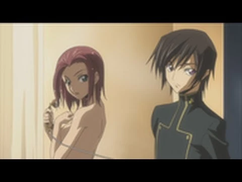

Nobody needs to know his identity.

Nobody needs to understand his personal motivations.

They only need to believe that Zero can defeat Britannia.

And for a while, that works brilliantly.

His speeches attract followers. His victories establish credibility. His apparent fearlessness inspires people who have spent years living under occupation.

But there's a difference between inspiring people and building durable political trust.

Lelouch increasingly relies on his achievements to justify his authority.

The underlying message becomes:

**Trust me because my plans work.**

Rather than:

**Trust me because you understand what I believe, why I make decisions, and what limits I place on myself.**

Those are very different foundations for leadership.

The first works extraordinarily well when the leader keeps winning.

The second matters when things go wrong.

Zero's mystery is useful because it prevents Britannia from easily identifying and attacking him.

But the same secrecy creates a vulnerability within his own organization.

His followers can believe in Zero's public ideals without knowing whether Lelouch's private objectives actually align with them.

And the more authority Zero accumulates, the more dangerous that gap becomes.

A revolutionary movement cannot permanently substitute one man's strategic brilliance for shared political understanding.

Eventually, its members must decide what they believe independently of the person giving orders.

Lelouch seems to understand how to create followers.

I'm less convinced he understands how to create an organization that could survive disagreeing with him.

## The Black Knights Are Not Simply Lelouch's Army

This is one of the most important political distinctions in the anime.

Lelouch wants to destroy Britannia.

But the Japanese resistance does not necessarily want to destroy the entire Britannian Empire.

Its members want liberation.

They want an end to occupation, discrimination, and the humiliation of being reduced to a numbered people.

Those goals overlap with Lelouch's ambitions, but they are not identical.

Lelouch's conflict with Britannia is intensely personal.

The empire destroyed his childhood. His mother was murdered. His sister was left vulnerable. His father discarded them.

His rebellion is therefore simultaneously political and familial.

For many Japanese resistance fighters, the objective is more immediate.

They want their country back.

And this raises a fascinating problem.

Suppose Britannia offered genuine Japanese independence through negotiation.

Would every member of the Black Knights still have a reason to fight for the empire's complete destruction?

Not necessarily.

Their alliance depends on overlapping interests, not identical motivations.

Lelouch's success temporarily conceals that difference because defeating Britannian forces advances both objectives.

But military cooperation doesn't erase political disagreement.

And this makes Zero's secrecy more dangerous than it initially appears.

The Black Knights are entrusting their revolution to someone whose ultimate objectives they don't fully understand.

Meanwhile, Lelouch is entrusting his personal war to people who may eventually consider their own goals achieved before his are.

That is not necessarily betrayal by either side.

It is a structural tension within the alliance.

## Suzaku: The Idealist Who Has Already Violated His Own Ideals

Suzaku is one of the most psychologically interesting characters in the series.

He initially appears to be Lelouch's moral opposite.

Lelouch believes that achieving a just outcome can require unacceptable methods.

Suzaku insists that the methods themselves matter.

Lelouch seeks to overthrow Britannia.

Suzaku seeks to reform it from within.

The obvious interpretation is that one represents revolution and the other reform.

But that distinction becomes much more complicated once we consider Suzaku's past.

Suzaku killed his own father.

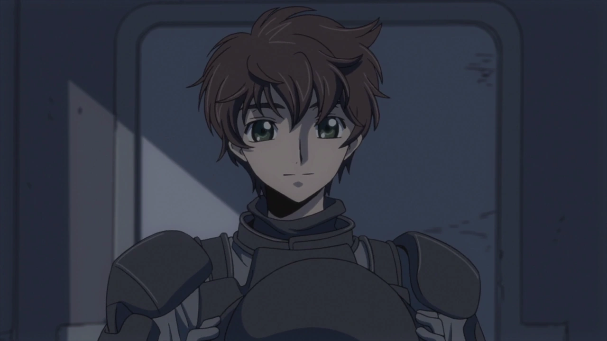

He believed that ending Japan's resistance would prevent further bloodshed, and he committed an irreversible act to bring about that outcome.

In other words, Suzaku has already done something very similar to what he condemns Lelouch for doing.

He chose a terrible means because he believed the consequences would justify it.

This makes his later moral philosophy fascinating.

Perhaps Suzaku's insistence on proper methods isn't simply an expression of his natural personality.

Perhaps it's also a response to guilt.

He has experienced what happens when someone decides that the ends justify the means.

And he desperately wants to believe he will never make that decision again.

That doesn't make his compassion fake.

He genuinely cares about people. He risks his life for others. He wants to reduce suffering.

But genuine compassion can coexist with a moral philosophy constructed partly to escape the memory of one's own actions.

Suzaku may not simply be arguing against Lelouch.

He may also be arguing against the version of himself who killed his father.

That's a much more interesting conflict than the idea that Suzaku is merely naive or hypocritical.

## Reform Versus Revolution Is Not a Simple Moral Contest

It's tempting to dismiss Suzaku's strategy because Britannia is so obviously oppressive.

But the anime gives his position enough substance that it deserves serious consideration.

Suzaku gains access to real military power.

His ability as the Lancelot's pilot gives him influence within an institution that would otherwise dismiss him because of his nationality.

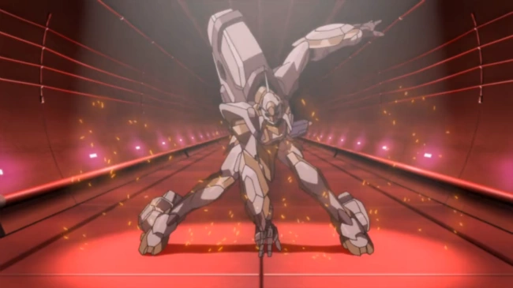

He is not merely making speeches about changing the system.

He is gaining the ability to act within it.

And Euphemia's proposed Special Zone for the Japanese creates an even more significant challenge to Lelouch.

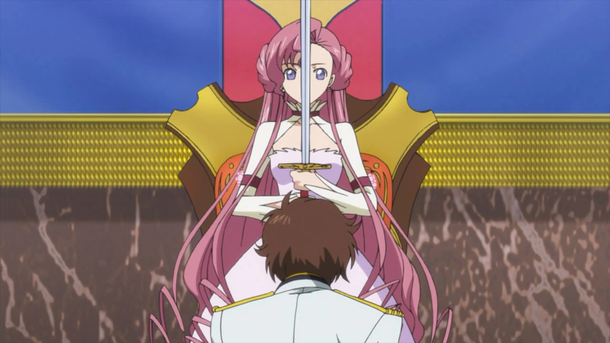

It suggests that meaningful concessions might be possible without overthrowing Britannia through war.

Of course, there are serious limitations.

A reform granted by an imperial princess remains dependent on the political structures that made the oppression possible.

A policy can be compassionate without being institutionally secure.

An occupied people might receive better treatment without obtaining genuine sovereignty.

But those weaknesses don't make the reform meaningless.

Suzaku's approach can produce real improvements while remaining vulnerable to the power of the empire.

Likewise, Lelouch's revolution can challenge the foundations of oppression while exposing civilians and resistance fighters to enormous risks.

Neither strategy becomes morally simple merely because its intentions are admirable.

What makes their conflict compelling is that both characters identify genuine weaknesses in the other's approach.

Suzaku sees the destruction caused by Lelouch's methods.

Lelouch sees the dependence and fragility of reforms granted by an oppressive institution.

Both have a point.

And both have personal reasons for refusing to accept the other's argument.

## Euphemia: The Political Threat Lelouch Couldn't Simply Defeat

Euphemia is devastating because she undermines Lelouch without behaving like a conventional enemy.

She genuinely wants to help the Japanese.

Her proposal isn't a perfect solution to Britannian imperialism, but it offers something Zero's revolution cannot easily dismiss:

A peaceful possibility.

Lelouch's political legitimacy depends partly on the belief that Britannia cannot be persuaded to change.

If an imperial princess can provide meaningful recognition and protection for Japanese identity, the argument for continued armed resistance becomes more complicated.

That doesn't mean Euphemia has solved the underlying political problem.

It means she has challenged the assumption that revolution is the only available route.

And Lelouch understands this.

The Special Zone threatens Zero not because it is cruel, but because it is potentially attractive.

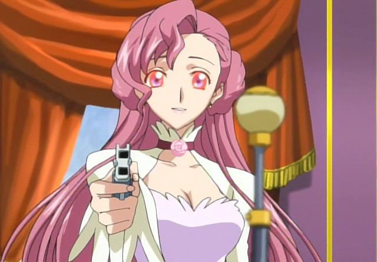

That is a brilliant political complication.

Euphemia is not trying to defeat Lelouch in battle.

She is making his rebellion less necessary to the people he claims to represent.

And because Lelouch personally cares about her, the conflict becomes even more difficult.

For once, he is facing someone whose sincerity is itself a strategic problem.

## Episode 23: A Brilliant Tragedy With a Convenient Mechanism

The Euphemia catastrophe is one of the most emotionally devastating moments in the first season.

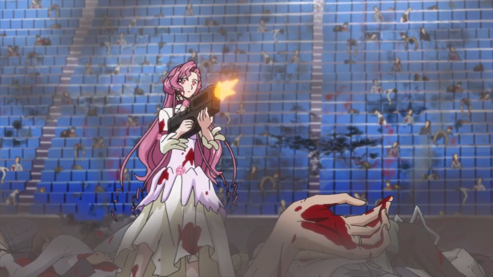

It is also a moment where I have reservations about the writing.

Mao's storyline established that Geass could become uncontrollable.

So the possibility of Lelouch losing control isn't introduced from nowhere.

But the exact timing is astonishingly convenient.

Lelouch's Geass becomes permanently active at precisely the moment when he jokingly uses an example that produces the worst possible political and personal consequences.

The emotional logic works.

The mechanical convenience is harder to ignore.

And I think both judgments can coexist.

The scene is tragic because Euphemia genuinely wanted peace.

It's tragic because Lelouch never intended to give that command.

It's tragic because the victims cannot know the difference between an accidental supernatural command and a deliberate imperial massacre.

And it's tragic because Lelouch must confront consequences that his intelligence cannot simply reverse.

But the fact that the tragedy works emotionally doesn't mean the plot device is beyond criticism.

The anime arranges an extraordinary coincidence to destroy a political possibility that had become inconvenient for Lelouch.

That deserves acknowledgment.

What makes the aftermath compelling is not that the mechanism was perfectly elegant.

It's that the characters respond to it in ways that reveal who they are.

## The Difference Between Intention and Responsibility

Euphemia's actions raise an uncomfortable question.

How much responsibility does someone bear for an action they did not freely choose?

She doesn't intend to massacre the Japanese.

Her behavior is overridden by Lelouch's Geass.

Yet the people who suffer cannot simply undo their suffering by learning that the command was accidental.

The consequences are real even when the intention is absent.

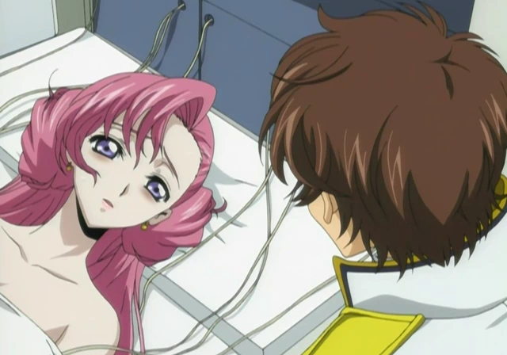

Lelouch's responsibility is similarly complicated.

He didn't intend to issue that particular command.

But Geass is a power he has repeatedly used to override the autonomy of others.

His mistake emerges from a broader pattern of treating other people's choices as something he can control.

The catastrophe is therefore both an accident and a consequence of the kind of power Lelouch has chosen to exercise.

That distinction matters.

Accidental harm isn't identical to deliberate cruelty.

But the absence of malicious intent doesn't automatically erase responsibility.

And Lelouch's subsequent decisions are separate moral choices.

What he does after the accident cannot be excused simply by pointing out that the original command was unintended.

This is where the anime becomes much more interesting than a simple story about a brilliant rebel fighting an evil empire.

It forces us to consider how intention, power, and consequences interact.

## C.C.: The Person Lelouch Cannot Reduce to a Strategy

C.C. occupies a strange position in Lelouch's life.

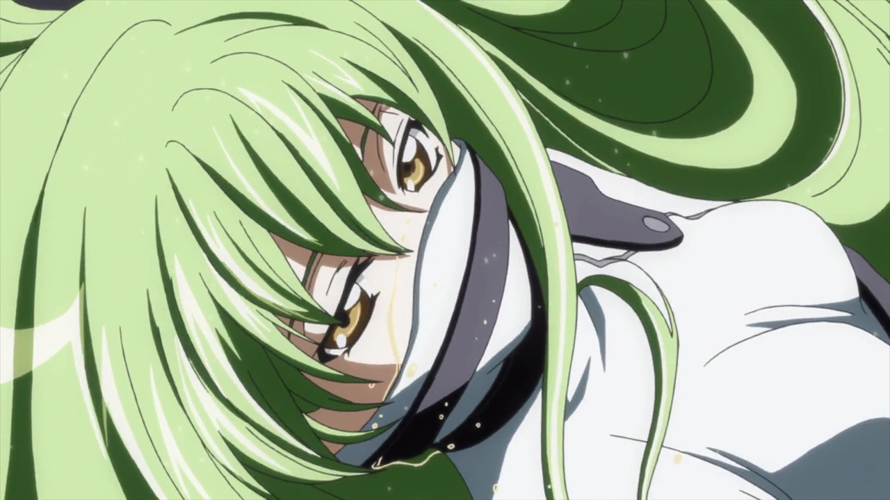

She knows his secret.

She understands the existence of Geass.

And she can see through much of the theatrical confidence he performs for everyone else.

But she isn't simply his emotional caretaker.

She has secrets of her own.

She withholds information. She challenges him. She refuses to become completely transparent.

And that makes their relationship unusually interesting.

Lelouch is accustomed to converting information into leverage.

If he understands someone's motivations, he can often predict or manipulate their actions.

But C.C. cannot be understood so easily.

He has glimpsed fragments of her past without fully understanding their context.

He possesses information that doesn't give him control.

That reversal matters.

Their relationship is built partly around the recognition that neither can completely understand or possess the other.

Lelouch can be more vulnerable around C.C. than around most of his allies.

But even here, vulnerability doesn't automatically produce perfect communication.

Both remain guarded.

Both have reasons to conceal their feelings and histories.

And neither can simply solve the other's suffering through intelligence.

For someone who tries to control every situation, Lelouch's inability to fully control this relationship may be precisely what makes it meaningful.

## Nunnally: The Personal Goal Behind the Political Revolution

Nunnally is central to Lelouch's motivations.

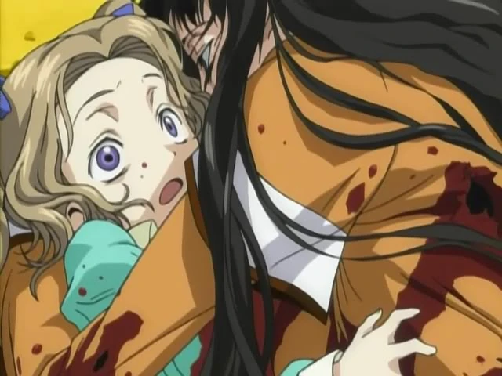

He wants to create a world where she can live peacefully.

He wants to protect her from the cruelty of Britannia.

He wants to destroy the structures that made their childhood suffering possible.

But there's a tension between doing something for another person and deciding what that person needs.

Lelouch's devotion is genuine.

Yet his methods frequently require secrecy, manipulation, and violence.

He wants to protect Nunnally from a world governed by coercion while using coercion to reshape that world.

That contradiction doesn't make his love insincere.

It makes the relationship between his intentions and his methods worth examining.

Lelouch is capable of extraordinary sacrifice for the people he loves.

But he often assumes that love gives him the responsibility to decide everything himself.

And that's a dangerous assumption.

The more he believes that only he can protect Nunnally, the more difficult it becomes for him to accept uncertainty, compromise, or another person's independent choices.

His devotion is simultaneously one of his most admirable qualities and one of the forces that can distort his judgment.

## The Emperor and the Politics of Strength

The Emperor represents the ideological foundation of the Britannian system.

His public philosophy glorifies strength and treats domination as an expression of the natural order.

The strong rule.

The weak are conquered.

Those who cannot defend themselves are expected to accept their position.

This isn't merely a personal attitude.

It provides a justification for imperial expansion, political hierarchy, and the systematic degradation of conquered peoples.

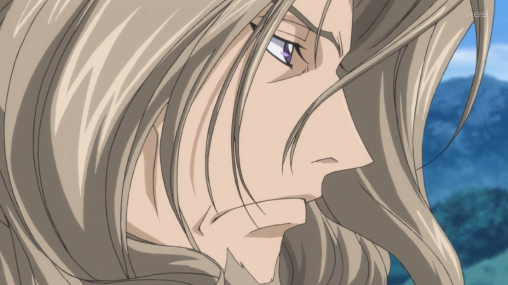

Britannia's treatment of Japan is therefore not simply an unfortunate side effect of its power.

It is connected to the values through which that power is publicly legitimized.

But there is an important distinction between understanding the Emperor's stated ideology and understanding his private motivations.

We know that Lelouch's childhood was shaped by his father's actions.

We know that Lelouch believes he and Nunnally were discarded.

We know that the Emperor's public philosophy is profoundly hostile to the kind of vulnerable life Lelouch wants to protect.

What we do not yet know, within the scope of these episodes, is everything motivating the Emperor's decisions.

It would be premature to treat Lelouch's interpretation of his father as a complete psychological explanation.

The Emperor remains partly mysterious.

And that uncertainty matters because Lelouch's rebellion is built around his understanding of what happened to his family.

His convictions may be sincere without his knowledge being complete.

## The Problem With Lelouch's Understanding of Himself

One of the most compelling aspects of Lelouch is that he seems extraordinarily good at reading other people while remaining unreliable about his own motivations.

He tells himself that he is acting for Nunnally.

And he is.

But he also wants revenge.

He wants recognition.

He wants to defeat the Emperor.

He wants to prove that the world that humiliated him can be overturned through his own intelligence.

Those motivations don't necessarily contradict one another.

People rarely act from a single pure intention.

The problem arises when Lelouch treats one motivation as though it explains everything.

If every action is justified as something done for Nunnally, then he doesn't have to confront the possibility that his own anger or pride is also influencing his decisions.

This is not evidence that his love is fake.

It is evidence that love can become entangled with identity, resentment, and ambition.

Lelouch is brilliant at identifying what other people want.

He is less comfortable asking why he wants what he wants.

And the mask of Zero gives him a convenient way to avoid that question.

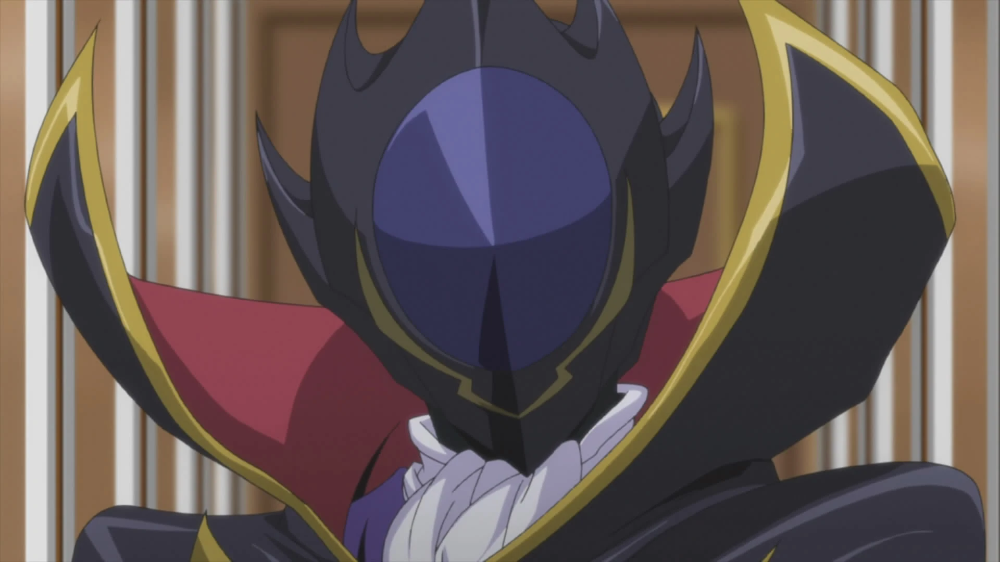

Zero has a political mission.

Lelouch has a personal history.

As long as the two appear identical, he doesn't have to examine the difference.

## The World Doesn't Stop Being Political Because Lelouch Is Emotional

Another reason I appreciate _Code Geass_ is that its political world doesn't exist solely to accommodate the protagonist.

Britannia has institutions, military capabilities, competing interests, and political actors who pursue their own objectives.

The Japanese resistance contains people with different priorities and degrees of commitment.

Technological developments can alter the balance of power independently of Lelouch's plans.

And even a successful military operation can create unexpected political consequences.

This prevents Lelouch's intelligence from becoming an automatic solution to every problem.

He can outmaneuver an opponent tactically while creating a more difficult strategic situation.

He can win a battle while weakening the political legitimacy of his cause.

He can inspire followers while creating expectations he may not be able to satisfy.

That distinction between tactical victory and political success is essential.

A revolution isn't won merely by defeating enemy units.

It must establish legitimacy, maintain alliances, and create a plausible alternative to the order it seeks to replace.

Lelouch is extraordinary at generating opportunities.

But creating an opportunity and governing its consequences are different skills.

## Why Suzaku and Lelouch Are More Similar Than They Admit

The conflict between Lelouch and Suzaku initially appears to be a conflict between opposite moral philosophies.

But their similarities are just as important.

Both are shaped by childhood trauma.

Both feel responsible for protecting others.

Both are willing to place extraordinary burdens on themselves.

Both believe they understand something fundamental that the other refuses to accept.

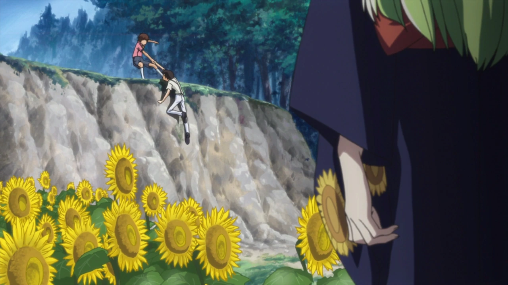

And both are capable of rationalizing their decisions through a larger moral objective.

Lelouch justifies manipulation through the future he wants to create.

Suzaku justifies cooperation with Britannia through the possibility of reform.

Neither is simply lying about his beliefs.

But both risk allowing their chosen methods to become inseparable from their identities.

For Lelouch, abandoning revolution could feel like abandoning Nunnally.

For Suzaku, abandoning reform could mean confronting the possibility that his attempt to make amends for killing his father has been misguided.

Their political disagreement is therefore also a psychological conflict.

They aren't merely debating which strategy will work.

They are defending the stories that allow them to live with themselves.

And that's why their confrontations carry so much emotional weight.

Each recognizes something in the other that he would rather reject.

## The Genius Who Cannot Control His Own Story

Lelouch is not a fake genius.

His intelligence is not an illusion.

His victories are not accidents.

And his failures do not prove that he was secretly incompetent all along.

The problem is his understanding of control.

He believes that sufficiently accurate information, sufficiently clever planning, and sufficiently decisive action can allow him to determine the outcome of almost anything.

But relationships are not equations.

Political movements are not private possessions.

And people do not become extensions of his will simply because he understands their motivations.

The tragedy of Lelouch is that his greatest strength continually reinforces his greatest weakness.

His plans work often enough that he becomes increasingly convinced that control is the answer.

When confronted with uncertainty, he tries to calculate harder.

When confronted with resistance, he tries to create a better strategy.

When confronted with emotional vulnerability, he puts the mask back on.

But the more he attempts to control the world, the more responsibilities he accumulates toward people whose lives cannot be reduced to strategic objectives.

He wants to protect Nunnally.

He wants to punish Britannia.

He wants to lead the Black Knights.

He wants to preserve his friendships.

He wants to remain the person who determines what happens next.

And he cannot necessarily have all of those things.

That is what makes the first 23 episodes so compelling.

_Code Geass_ is not simply asking whether Lelouch is intelligent enough to defeat Britannia.

It is asking whether intelligence is enough to navigate a world of independent people, competing ideals, and consequences that cannot be undone.

Lelouch wants to be the player moving the pieces.

But the people around him are not pieces.

And he is not outside the board.

He is one of the people whose lives are being changed by the game.

**The genius can control a battle. He can command an army. He can even force another person to obey him.**

**What he cannot do is make the world mean exactly what he wants it to mean.**
