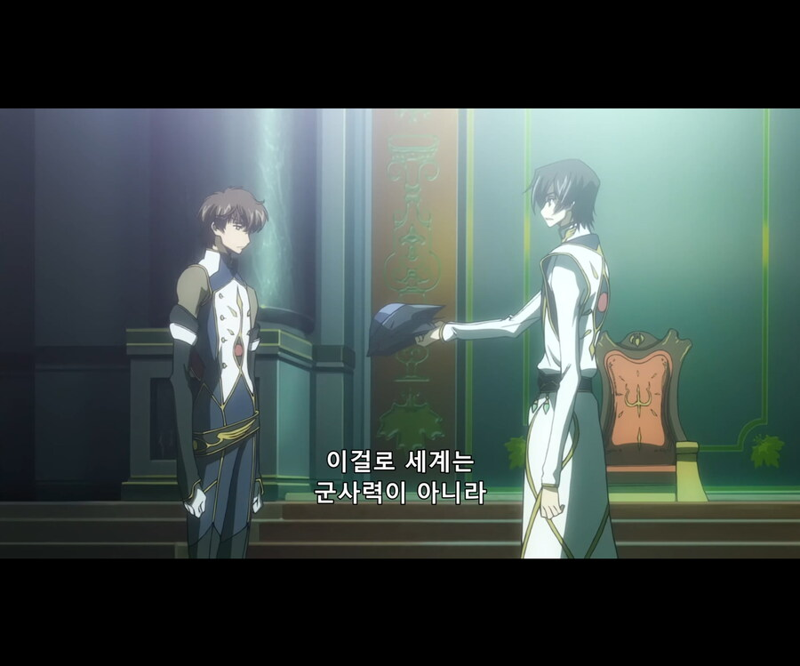
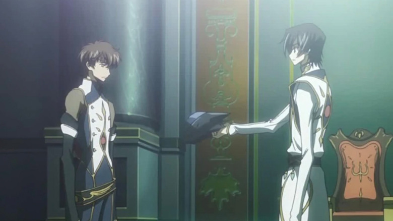
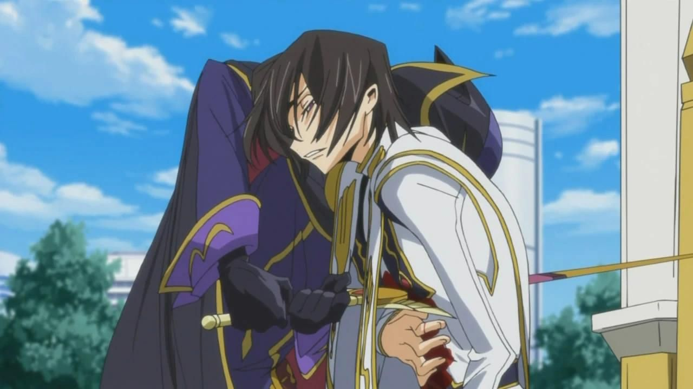
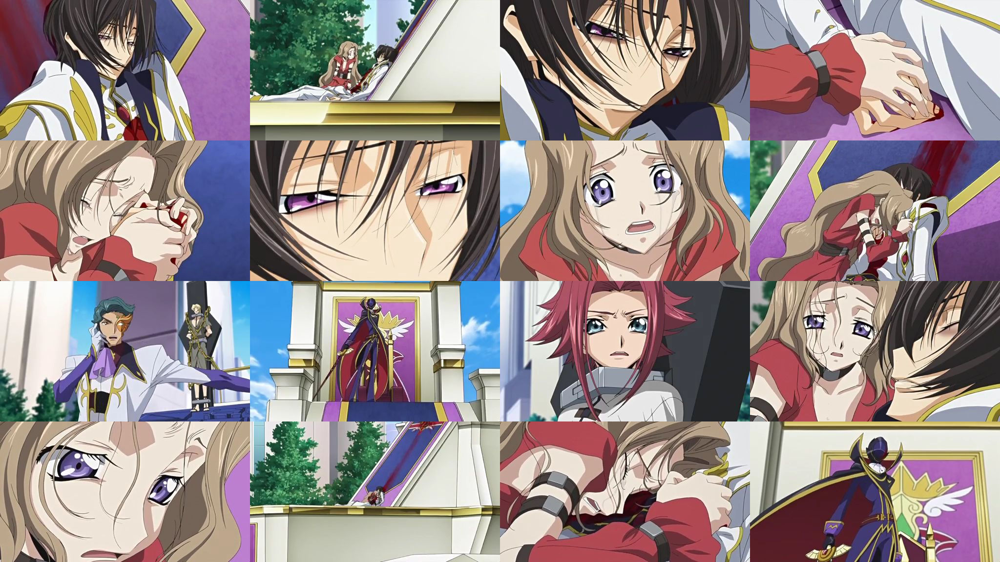
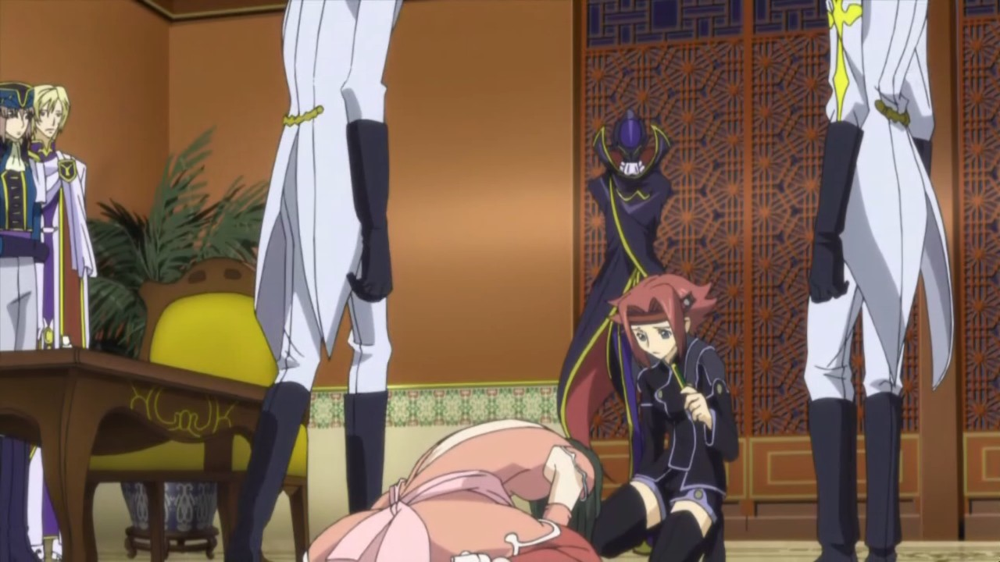
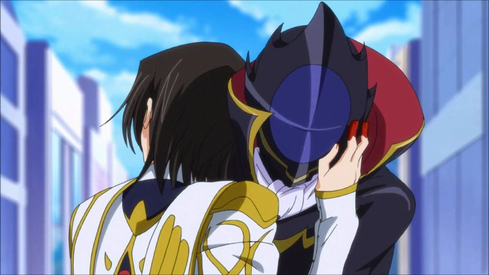
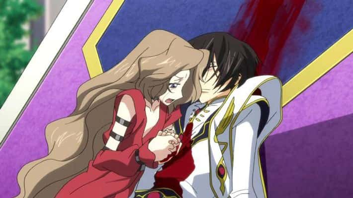

# Code Geass: The King Who Sacrificed Himself

_R2 Episode 25 — Re;_

**The king moves first.**

It's a philosophy Lelouch introduces near the beginning of _Code Geass_. A king who refuses to move cannot expect his subordinates to follow.

And it's such a Lelouch thing to say.

He's a strategist. A manipulator. A revolutionary who sees the world as a chessboard and believes that, with enough intelligence and determination, he can change the arrangement of its pieces.

For fifty episodes, I've watched him do exactly that.

He moves people, nations, armies, and entire political systems. He makes extraordinary decisions, commits terrible acts, suffers devastating losses, and somehow continues moving forward.

Then comes the final episode.

The Zero Requiem.

And suddenly, I understand.

**The king was always going to move first.**

But this time, he's moving toward his own death.

HOLY FLUFFING HELL.

## The Final Move

For much of the final arc, Lelouch's actions are difficult to reconcile with the person we've followed.

He becomes Emperor of Britannia. He consolidates power, defeats his enemies, and establishes himself as a tyrant.

The boy who began by rebelling against an empire now sits at the top of one.

And he's terrifyingly effective.

Lelouch has always possessed an extraordinary ability to anticipate people's reactions. He understands how power works, how symbols influence societies, and how fear can direct human behaviour.

Now he uses those abilities to make himself the most hated person in the world.

Then, during the victory parade, Zero appears.

And kills him.

For a moment, the scene is shocking.

Then the pieces begin to fall into place.

**The Zero Requiem.**

Lelouch has deliberately concentrated the world's hatred upon himself. By becoming the common enemy of people who were previously divided, he creates the conditions for them to move beyond their conflicts.

And then he arranges for Zero—the symbol of resistance and hope—to kill that enemy.

Himself.

It's an extraordinary plan.

But what struck me most wasn't simply the intelligence behind it.

It was how completely it made sense.

The final revelation didn't feel like an arbitrary twist invented to make Lelouch sympathetic.

It felt like the culmination of everything I'd been watching.

His understanding of politics. His willingness to manipulate perceptions. His ability to accept personal suffering in pursuit of an objective. His obsession with creating a gentler world.

Everything converges on this one decision.

**Lelouch makes himself a pawn in his own plan.**

And that might be the most fascinating move he ever makes.

## The King Who Became a Pawn

Throughout _Code Geass_, Lelouch has approached conflict as a strategist.

He sees possibilities that others overlook. He anticipates responses several moves ahead. He manipulates the positions of allies and enemies to produce outcomes that initially seem impossible.

His intelligence is one of the greatest pleasures of watching the series.

But the Zero Requiem transforms that relationship with strategy.

Usually, the purpose of sacrificing a piece in chess is to gain an advantage for the pieces that remain.

The king is the one piece that must ultimately be protected.

Yet Lelouch's final plan requires the opposite.

**He sacrifices the king to protect everyone else.**

And that brings us back to his original philosophy.

The king must move first.

At the beginning, that idea expresses Lelouch's belief that a leader must act rather than remain safely behind others.

By the finale, he takes it to its ultimate conclusion.

He doesn't merely accept the risks of leadership.

He makes his own death an essential part of the strategy.

The player has placed himself on the board.

The strategist has become the sacrificial piece.

And somehow, it's still entirely consistent with who Lelouch has always been.

That's what I love about the Zero Requiem.

It doesn't discard his defining characteristics to manufacture a heroic ending.

It uses those characteristics to create one.

Lelouch remains calculating, manipulative, ambitious, and extraordinarily intelligent.

He simply directs all of it toward a future in which he will no longer exist.

**The king's final move is to remove himself from the board.**

## Suzaku: The Cruellest Inversion

And then there's Suzaku.

OH MY GOD, SUZAKU.

His participation in the Zero Requiem is one of the most fascinating reversals in the entire series.

Suzaku's life has been shaped by the death of his father.

He killed Genbu Kururugi because he believed it would prevent further bloodshed. He thought that eliminating one person could produce a better outcome for everyone else.

But the consequences haunted him.

His guilt influenced his beliefs, his decisions, and his relationship with the world.

For much of the series, Suzaku and Lelouch stand on opposite sides of a fundamental disagreement.

Lelouch believes that changing a corrupt system requires confronting and destroying it.

Suzaku believes that change should come from working within the system.

Both want a better world.

Both become entangled in contradictions.

And both repeatedly discover that their methods carry terrible costs.

Then, in the finale, Suzaku kills his best friend.

**Once again, he kills someone in pursuit of a better future.**

But this time, the circumstances are profoundly different.

He isn't acting alone, hoping that the death of one person will somehow resolve a conflict.

He and Lelouch have constructed a plan together. They understand its purpose and have accepted the consequences.

And those consequences are devastating.

Lelouch dies.

Suzaku must live.

But he can no longer live as Suzaku Kururugi.

He must become Zero.

The very identity he once fought against.

The symbol associated with the friend he has just killed.

And he must continue carrying that identity into the future.

There's something almost cruelly perfect about it.

Suzaku once killed his father believing that death could resolve a conflict.

Now he kills his best friend as part of a plan that actually establishes peace.

But rather than escaping his guilt, he accepts a lifelong responsibility.

**Lelouch sacrifices his life. Suzaku sacrifices the life he could have lived.**

And suddenly, their alliance makes complete sense.

They aren't simply setting aside their differences because the story needs them to cooperate.

Their experiences have brought them to a point where they can finally pursue the same objective through a shared strategy.

Neither can accomplish the Zero Requiem alone.

Lelouch needs someone who can kill him.

Suzaku needs a purpose that gives meaning to the life he must continue living.

And together, they create something neither could have achieved separately.

## Nunnally: The Person Left Behind

Then there's Nunnally.

And this is where the triumph becomes heartbreaking.

Throughout the series, Lelouch's desire to protect Nunnally has been one of his most consistent motivations.

He wants her to live in a gentler world.

A world where she doesn't have to suffer because of the ambitions and conflicts of powerful people.

Yet the Zero Requiem requires him to become the very sort of person she would oppose.

He makes himself a tyrant.

He allows her to believe the worst of him.

And when she finally understands what he has done, he's dying in front of her.

**She's too late.**

Too late to understand his intentions while he can still speak to her.

Too late to tell him what she thinks.

Too late to have her brother back.

And the contrast between her grief and the crowd's celebration is devastating.

To the world, Lelouch's death means liberation.

The tyrant is gone.

Zero has returned.

People can finally begin moving toward a better future.

But Nunnally isn't celebrating.

She's crying over her brother.

The person who wanted to give her a peaceful world is no longer there to share it with her.

And that hurts.

Of course, she isn't literally the only person mourning Lelouch.

Suzaku knows exactly what he's lost. C.C. understands the significance of his choice. Others carry their own complicated feelings about him.

But Nunnally's grief is the one the finale places directly against the world's joy.

**Everyone else sees the death of an emperor.**

**She sees the death of her brother.**

And neither perspective makes the other disappear.

The world has been given something extraordinary.

Nunnally has lost something irreplaceable.

The Zero Requiem succeeds, and that success makes her loss no less painful.

## Kallen and the World That Remains

One thing I especially appreciate about the finale is that it doesn't end immediately after Lelouch dies.

We get to see what happens afterward.

Kallen's narration shows us a world beginning to recover.

She returns to school. Ordinary life resumes. The atmosphere is noticeably different from the world of constant conflict and political upheaval we've spent the series watching.

And this matters.

Because the Zero Requiem isn't presented merely as an idealistic plan whose success we must imagine.

**The anime shows us that it worked.**

The peace Lelouch sought has begun to take shape.

People are rebuilding.

The world is moving forward.

That doesn't mean humanity will never experience another conflict. No single political strategy can guarantee eternal peace.

But the ending doesn't ask us to remain cynical about what Lelouch accomplished.

It gives us evidence that his sacrifice created the future he intended.

And I find that enormously satisfying.

After everything that has happened, after all the suffering and the impossible decisions, we finally get to see people living ordinary lives.

Not because every problem has vanished.

But because the world has been given the opportunity to move beyond the conflicts that defined it.

And Lelouch isn't there.

That's the price.

He created the conditions for a better world, but he cannot participate in it.

**The future belongs to the people who survive him.**

## I Never Needed to Forgive Lelouch

There's something strange about my relationship with Lelouch as a character.

When I think about everything he's done throughout the series, I know that many of his actions are morally questionable.

Some are outright terrible.

He manipulates people. He makes decisions that cost lives. His plans don't always work, and the consequences can be devastating.

Yet I never really found myself condemning him.

I don't entirely know why.

It's not that I believe everything he did was justified.

And it's not that the Zero Requiem suddenly erased every mistake he ever made.

I simply never approached Lelouch as someone whose moral worth I needed to calculate.

I watched him struggle.

I watched him make decisions.

I watched his plans succeed, collapse, and produce consequences he could never fully control.

I watched him lose people he cared about.

And through it all, I remained invested in understanding what he was trying to accomplish.

So when the Zero Requiem was revealed, I didn't experience it as a moment of forgiveness.

**I experienced it as a moment of understanding.**

Suddenly, the final pieces of his character fell into place.

His apparent transformation into a tyrant wasn't the abandonment of everything he'd believed.

It was the final stage of a plan that required him to become the world's enemy.

And somehow, that felt right.

Not morally uncomplicated.

Not painless.

Just right for Lelouch.

The ending doesn't require me to forget what happened before it.

It allows me to see where everything was leading.

And that's far more satisfying than a simple declaration that Lelouch was either a hero or a villain.

## The King Has Made His Last Move

_Code Geass_ is a series about rebellion, power, ideology, ambition, and the consequences of trying to change the world.

But it's also the story of an extraordinarily intelligent boy who believes he can construct a better future through the force of his own decisions.

And in the end, he does.

Not by ruling the world forever.

Not by defeating every enemy and taking his place as a benevolent emperor.

But by creating a plan in which his own death becomes the final move.

Suzaku must live as Zero.

Nunnally must live without her brother.

The world must move forward without the man who made its new beginning possible.

And Lelouch?

He gets no future.

But he leaves one behind.

That's what makes the Zero Requiem extraordinary to me.

Not simply the tragedy of his death.

Not merely the brilliance of the strategy.

**It's the moment when I finally understand the whole plan—and realise that Lelouch has made himself its final sacrifice.**

The king moves first.

And this time, the king doesn't move to control the pieces.

**He moves so that everyone else can finally live without him.**

_Farewell, Lelouch vi Britannia._

**ALL HAIL LELOUCH.** ♟️
